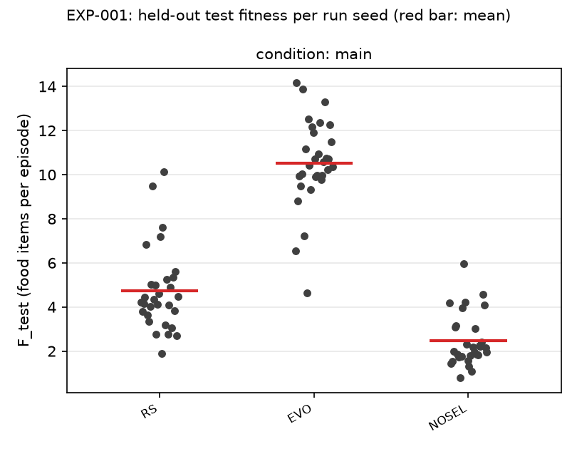
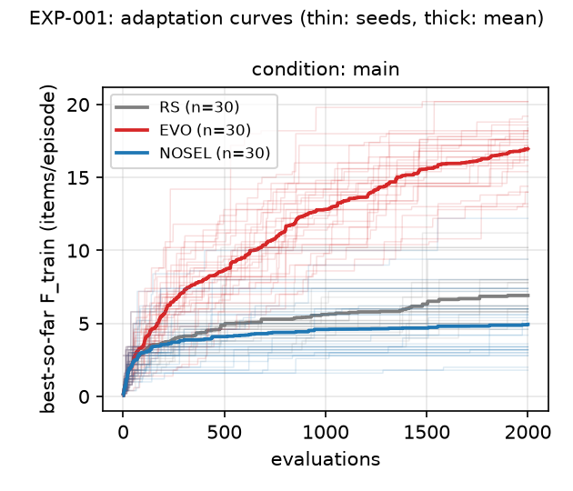
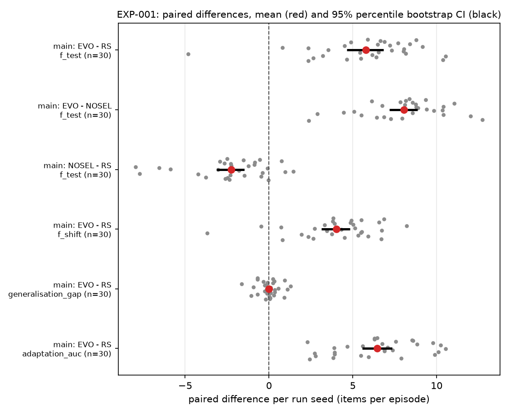

<!-- SPDX-License-Identifier: LicenseRef-EVOLVE-NC-Research-1.0 -->
# EXP-001 report: evolutionary selection versus random search at equal evaluations

## 1. Identification

| Field | Value |
|---|---|
| Experiment | EXP-001 |
| Status | **Confirmatory, complete** (90 of 90 planned runs, 0 failed, 0 retried) |
| Date of runs | 2026-11-24T23:33:18Z to 2026-11-24T23:35:03Z (UTC; 2026-11-25 local time) |
| Report version | 1.0 (M3; written from the committed results after the owner's approval of 2026-11-25, D-012) |
| Authorship | Mohamed Bechir Kefi (approved C3, no affiliation). An AI system was used as a research and development assistant; it is not an author. |
| Protocol | `research/experiments/EXP-001/protocol.md` v1.0, SHA-256 21e0a7400c4b5b660937e416d6bb7a454c1e3f9f822bd6232f2381586a36253f; main protocol `research/protocol.md` SHA-256 3543a6fdf886c3c6fa0588344353eeb715e7706800884b165c2fe6378daa1e85 |
| Config | `experiments/configs/EXP-001.json`, file SHA-256 aaaf6e09d7dbe223ae29e890f4ec74ec0d50219608594ce3b5aa78634999fdae, canonical hash accc5309178ee616b60e2f0f3fc09fb8634202c12ca5fe8a1409cae5436c5239 |
| Provenance revision | 5d39c9bf1eae7356b1fa837642e02e4bde68e186 (clean tree; `git_dirty` false in every run manifest) |
| Scope | Simulation of a synthetic grid world only. Not evidence about biological evolution or general intelligence. |

## 2. Executive summary

**Question.** At a fixed budget of 2,000 policy evaluations, does evolutionary selection (EVO) return a foraging policy with higher held-out test fitness than independent random search (RS)?

**Method.** 30 paired run seeds (0 to 29), three arms (RS, NOSEL, EVO), 200 held-out test environments shared by every run, paired percentile bootstrap over run seeds (10,000 resamples, analysis seed 0), frozen decision rule.

**Outcome.** Mean held-out fitness was 10.520 food items per episode for EVO and 4.728 for RS. The mean paired difference EVO minus RS is **5.791 items per episode, 95 percent CI [4.644, 6.844]**, d_z 1.85 (CI [1.17, 3.27]); EVO exceeded RS in 29 of 30 seeds. Under the frozen rule (lower bound above 0) **H1 is supported**.

**Principal caveat.** The result holds for one synthetic task, one policy architecture and one set of search hyperparameters at E = 2,000 with K = 5 resampled training environments. EXP-003 found the advantage inconclusive with K = 1 fixed training environment, and EXP-002 found that the frozen sigma 0.1 was not the best setting tested. The direction of this contrast had been seen on an exploratory pool before the freeze (disclosed, section 7).

## 3. Rationale and literature

Simple genetic algorithms with Gaussian mutation and truncation selection have trained deep reinforcement learning policies competitively (Such et al. 2017, arXiv:1712.06567), and evolution strategies are a scalable black-box alternative (Salimans et al. 2017, arXiv:1703.03864). Random search is a strong baseline (Bergstra and Bengio 2012, JMLR 13; Mania et al. 2018, arXiv:1803.07055), so an evolutionary method has to be compared with it at equal budget. Results in this area vary with seeds and evaluation details (Henderson et al. 2017, arXiv:1709.06560; Colas et al. 2018, arXiv:1806.08295; Agarwal et al. 2021, arXiv:2108.13264), which motivates paired seeds and interval estimates. Gap addressed: a small, fully reproducible, paired, held-out comparison of selection against random search and a no-selection control in one grid world, with run-level uncertainty. Sources are those verified in `research/literature_review.md`.

## 4. Hypotheses and operational definitions

- `f(theta, e)`: food items consumed by policy `theta` in one 100-step episode of environment `e` (16 x 16 toroidal grid, 24 clustered food items), in `[0, 24]`.
- `F_test(theta) = (1/200) sum_m f(theta, e_m)` over 200 fixed environments from the confirmatory test pool, disjoint from the training pool (items per episode).
- Each arm spends exactly E = 2,000 evaluations; one evaluation scores a policy on K = 5 freshly drawn training environments. Every arm returns the policy with the highest training fitness it evaluated.
- Estimand: `delta = E_s[F_test(EVO, s) - F_test(RS, s)]` over run seeds `s`.
- H0: `delta <= 0`. H1: `delta > 0`. Supported if the 95 percent CI lower bound is above 0; contradicted if the upper bound is at or below 0; otherwise inconclusive (not equivalence).
- Control NOSEL: the EVO population scheme with uniformly random parents (neutral drift). Predeclared expectation (amendment C.3): NOSEL below RS. NOSEL is a control for selection, not a competitor to RS.

## 5. Methodology

- **Policy.** Feed-forward network, 25 inputs (24 cells of a 5 x 5 egocentric window plus a bias), 8 tanh hidden units, 4 outputs (forward, turn left, turn right, stay), argmax action; 236 parameters; initial `theta ~ N(0, 1)`.
- **Arms.** RS: 2,000 independent draws. EVO: population 50, 40 generations, truncation selection of the top 10, one elite re-evaluated, Gaussian mutation sigma 0.1. NOSEL: as EVO with uniformly random parents. Generation 0 of EVO and NOSEL equals the first 50 RS draws of the same seed.
- **Seeds.** Run seeds 0 to 29 under root seed 20261124; `SeedSequence` spawn keys separate the search, training, test and shifted pools (disjointness tested).
- **Data.** No external data (D-002). Environments are generated from recorded seeds; data manifest `data/manifest.json`, SHA-256 0d1dad1989d1a6d8013a974902d831b570e9f121a622acd782367d501a230f99.
- **Hardware and software.** Apple M1 Pro, macOS 15.3.1, Python 3.12.1, NumPy 2.5.4. Two worker processes at `nice 10`.
- **Budget.** 2,000 evaluations x 5 episodes x 100 steps per run, plus 200 test, 200 shifted and 200 fresh training episodes for the returned policy. Wall-clock recorded, not budgeted.
- **Statistics.** Frozen plan (`research/protocol.md` B.7): mean paired difference with a 95 percent percentile bootstrap CI over run seeds (10,000 resamples, seed 0), d_z with its bootstrap CI, Wilcoxon signed-rank (normal approximation) as robustness only. Secondary contrasts are estimates without significance claims. Computed by `scripts/analyse_frozen.py`, committed before any confirmatory output (D-011).

## 6. Implementation verification

- Full test suite before the runs: 135 passed (`tests/` covers mutation bounds, golden fitness scoring with a hand-built policy, the batched engine against a scalar reference, determinism across processes, seed-pool disjointness, the freeze guard, the CLI and the analysis script).
- Exploratory smoke run (protocol B.9; exploratory seeds 1000 and 1001, exploratory pools; J-0007): 6 runs, 0 failures.
- Metric validation on known cases (J-0008): golden tests 50 passed; `scripts/validate_results.py` checks 11 identities per run (F_test, F_shift and the gap from stored episodes, AUC and best training fitness from the stored trace, evaluation count, score bounds, exploit fractions, K = 1 null fields): 0 failures on the smoke runs and 0 failures on the 90 EXP-001 runs.
- The replay invariant (food consumed equals the decrease of food on the grid) is enforced in every simulated episode; no run aborted.
- The implementation operationalises the hypothesis as written: same budget, same output-selection rule, shared test set, matched generation 0.

## 7. Execution record

- Command: `./scripts/run_confirmatory.sh EXP-001 2`, which runs `PYTHONPATH=src nice -n 10 .venv/bin/python -m evolve run --config experiments/configs/EXP-001.json --out results/confirmatory/EXP-001 --workers 2` through the freeze guard (all hashes in `research/freeze.json` matched).
- Start 2026-11-24T23:33:18Z, end 23:35:03Z, exit status 0 (`run_provenance.json`, `matrix_manifest.json`). Load average 6.19 at start and 37.57 at end: the machine was shared with processes not started by this session.
- Run ids `EXP-001.main.{RS,NOSEL,EVO}.s0000` to `.s0029`: 90 planned, 90 ok, 0 failed, 0 retried, 0 dropped.
- Mean wall-clock per run: RS 1.718 s, NOSEL 1.863 s, EVO 2.725 s.
- Deviations from the frozen protocol: none.
- Owner decisions after the runs (owner, 2026-11-25, "approve all recommendations, RIGGED A"; D-012): reports are written from committed results only; the EXP-002 sigma result is "a finding against EXP-002's assumption about the setting, under the contradicting-result rule. H1 (EXP-001) stands."
- Disclosure (C4): an exploratory pilot on a separate pool (J-0004, seeds 1000 to 1009) had shown EVO minus RS = 7.923 items, CI [6.462, 9.529], before the freeze.

## 8. Results

**TAB-1. Held-out and secondary metrics by arm (mean over 30 run seeds; items per episode unless stated).** Source: `results/confirmatory/EXP-001/report/summary.csv`.

| Arm | F_test mean (SD) | F_test min to max | F_train_fresh | F_shift | Training fitness of returned policy | Stay fraction | Genotypic diversity | Behavioural diversity |
|---|---|---|---|---|---|---|---|---|
| RS | 4.728 (1.897) | 1.880 to 10.140 | 4.749 | 3.462 | 6.920 | 0.149 | 21.69 | 0.619 |
| NOSEL | 2.474 (1.193) | 0.790 to 5.970 | 2.508 | 1.850 | 4.940 | 0.270 | 16.73 | 0.512 |
| EVO | 10.520 (2.018) | 4.640 to 14.165 | 10.534 | 7.481 | 16.960 | 0.025 | 5.01 | 0.368 |

**TAB-2. Paired contrasts (unit: run seed, n = 30 pairs).** Source: `results/confirmatory/EXP-001/analysis/analysis.json`.

| Contrast | Metric | Role | Mean diff | 95% CI | d_z [95% CI] | Seeds +/- | Wilcoxon p | Reading |
|---|---|---|---|---|---|---|---|---|
| EVO - RS | F_test | primary | **5.791** | **[4.644, 6.844]** | 1.85 [1.17, 3.27] | 29/1 | 4.3e-06 | **H1 supported** |
| EVO - NOSEL | F_test | secondary | 8.046 | [7.173, 8.874] | 3.33 [2.57, 4.93] | 30/0 | 1.7e-06 | interval above 0 (estimate) |
| NOSEL - RS | F_test | secondary | -2.255 | [-3.110, -1.476] | -0.96 [-1.34, -0.70] | 3/27 | 2.2e-05 | interval below 0, as predeclared (C.3) |
| EVO - RS | F_shift | descriptive | 4.020 | [3.138, 4.845] | 1.63 [1.04, 2.86] | 28/2 | 5.2e-06 | interval above 0 (estimate) |
| EVO - RS | generalisation gap | descriptive | -0.006 | [-0.229, 0.216] | -0.01 [-0.36, 0.38] | 17/13 | 0.85 | interval contains 0 |
| EVO - RS | adaptation AUC | descriptive | 6.445 | [5.566, 7.336] | 2.59 [2.14, 3.46] | 30/0 | 1.7e-06 | interval above 0 (estimate) |

*FIG-1.* Held-out test fitness of the returned policy, one point per run seed (n = 30 per arm). Red bar: mean over seeds. Unit: food items per episode.

*FIG-2.* Best-so-far training fitness (mean of K = 5 training episodes) against evaluations; thin lines are seeds, thick lines means (n = 30 per arm). Best-of-many training fitness is biased upwards (winner's curse); held-out fitness is in FIG-1.

*FIG-3.* Paired differences per run seed (grey points), mean (red) and 95 percent percentile bootstrap interval over run seeds (black bar, 10,000 resamples), n = 30 pairs per row. Dashed line: no difference.

Degenerate-case checks (`results/confirmatory/EXP-001/report/report.md`): no returned policy scored 0 on the test set; no run reached the 24-item ceiling; no final population had zero behavioural diversity; eight returned policies stayed in place on more than half of the test steps (seven NOSEL, one RS, none EVO).

## 9. Interpretation

**Expected versus observed.** Expected: EVO above RS (H1) and NOSEL below RS (C.3). Observed: both, with intervals clear of 0.

**Measured.** EVO returned policies with higher held-out fitness than RS in 29 of 30 paired seeds. The same direction holds on the shifted distribution (uniform food, 16 items), never used for any choice.

**Competing explanations (protocol section 4).**
(a) *Local mutation search without selection.* NOSEL, with the same mutation and budget but no selection, scored 8.046 items below EVO and 2.255 below RS. Mutation from 50 starts without selection did not produce the advantage. EXP-002 examines this further.
(b) *Overfitting to training environments.* The re-measured generalisation gap does not differ between EVO and RS (CI [-0.229, 0.216]); with K = 5 resampled environments, fresh training-pool fitness matches test fitness. EXP-003's K = 1 condition, where the result was inconclusive, shows that this depends on resampled training.
(c) *Scoring exploit.* EVO policies stayed in place on 2.5 percent of test steps on average; the replay check passed in every episode. The audit indicates no exploit.
(d) *Winner's curse.* The training fitness of the returned policy overstates its held-out fitness (EVO 16.960 against 10.520; RS 6.920 against 4.728). All arms share the rule and the test set is fresh, so the bias does not favour one arm in the primary metric.
(e) NOSEL below RS was predeclared and was observed; it is not evidence against the design.

**Model-dependent inference.** The pattern is consistent with the protocol's mechanism: fitness is locally correlated in parameter space, so offspring of selected parents concentrate the budget in productive regions. This is an interpretation, not a direct measurement.

**Literature.** The direction agrees with reports that simple genetic algorithms are competitive black-box optimisers (Such et al. 2017). It does not bear on Mania et al. (2018), whose random search is a local method with a step rule, not independent sampling.

**Robustness.** The Wilcoxon signed-rank check agrees with the bootstrap (p = 4.3e-06).

## 10. Threats to validity

- **Internal.** Arms share seeds, test set, budget and output rule. The direction of the primary contrast was seen on a separate exploratory pool before the freeze (C4).
- **Construct.** Fitness counts food items in a synthetic task; it is not a measure of intelligence or of biological adaptation.
- **External.** One environment family, one network size, one set of P, G and truncation values. The frozen sigma 0.1 was not the best setting tested (EXP-002, D-012), so this effect size is not an upper bound. RS is independent sampling, not a tuned local random search.
- **Design dependence.** The advantage was inconclusive under K = 1 fixed training (EXP-003, C-009); the claim is restricted to resampled training.
- **Statistical.** n = 30 run seeds; percentile bootstrap without small-sample correction. Episodes within a run are averaged, not treated as independent units.
- **Hardware.** Runs shared the machine with other workloads; this affects wall-clock only (determinism across processes is tested).

## 11. Conclusion and next experiment

Within this simulation, at E = 2,000 with K = 5 resampled training environments, evolutionary selection returned policies with higher held-out foraging fitness than independent random search: 5.791 items per episode more (95 percent CI [4.644, 6.844], n = 30 paired seeds). H1 is supported under the frozen rule and stands after the owner's decision on EXP-002. The claim does not extend to the K = 1 fixed-training design (EXP-003). A follow-up, under a new EXP id, could compare EVO with a tuned local random search and test further training designs.

## 12. Reproduction appendix

- Dependencies: `uv.lock` (numpy 2.5.4, matplotlib 3.11.2, pytest 9.2.0, hypothesis 6.170.15); Python 3.12.1.
- Data manifest: `data/manifest.json` (synthetic only).
- Commands: `reproduction.md` in this folder.
- Raw results: `results/confirmatory/EXP-001/runs/` (90 files, schema `evolve.run_result` 1.1.0), `manifests/`, `matrix_manifest.json`, `run_provenance.json`, `run.log`; checksums in `results/confirmatory/EXP-001/sha256_manifest.json`.
- Tables and figures: `results/confirmatory/EXP-001/report/` (`summary.csv`, `metrics.csv`, FIG-1, FIG-2) and `analysis/` (`analysis.json`, FIG-3); copies in this folder (`metrics.csv`, `config.json`, `run_manifest.json`, `figures/`).
- Figure regeneration: `PYTHONPATH=src .venv/bin/python -m evolve report --results results/confirmatory/EXP-001` and `.venv/bin/python scripts/analyse_frozen.py EXP-001`.
- References: `research/paper/references.bib`, verified in `research/literature_review.md`.
