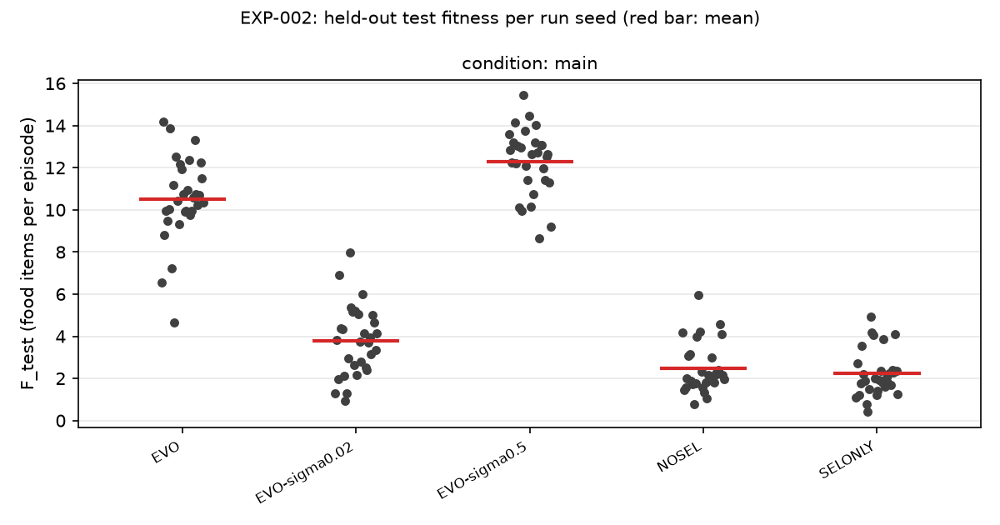
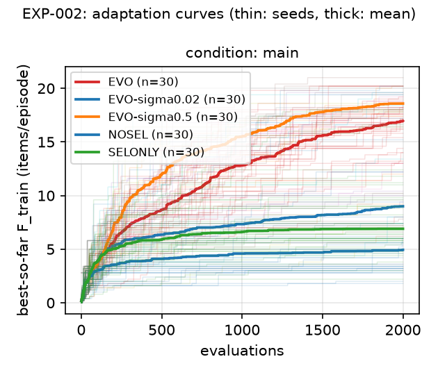
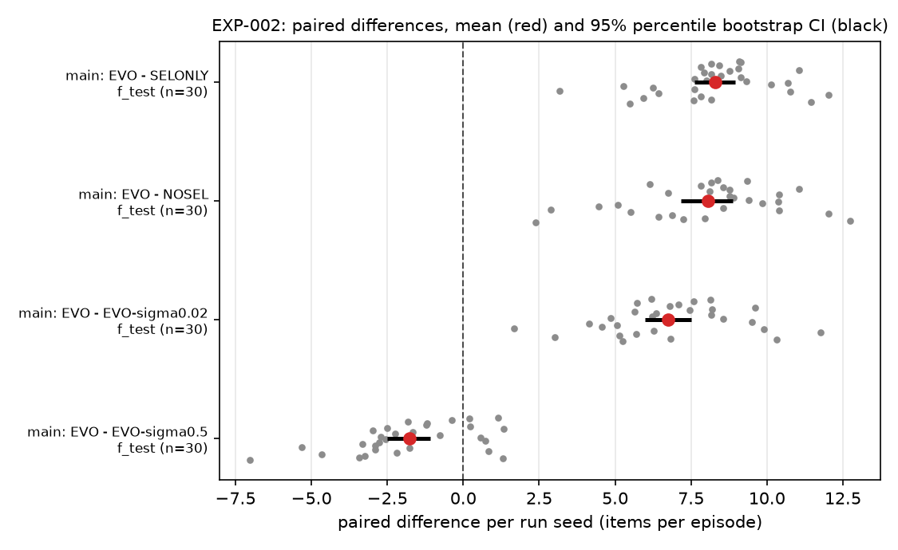

<!-- SPDX-License-Identifier: LicenseRef-EVOLVE-NC-Research-1.0 -->
# EXP-002 report: ablations of mutation and selection

## 1. Identification

| Field | Value |
|---|---|
| Experiment | EXP-002 |
| Status | **Confirmatory (secondary, estimation-focused), complete** (150 of 150 runs as committed, 0 failed, 0 retried). Contains a contradicting result under the protocol's rule (owner's classification, D-012). |
| Date of runs | 2026-11-24T23:35:03Z to 2026-11-24T23:40:48Z (UTC; 2026-11-25 local time) |
| Report version | 1.1 (M4 evidence audit, 2026-11-25: citation wording corrected to abstract-level statements; no number changed). 1.0 (M3) was written from the committed results after the owner's approval of 2026-11-25, D-012 |
| Authorship | Mohamed Bechir Kefi (approved C3, no affiliation). An AI system was used as a research and development assistant; it is not an author. |
| Protocol | `research/experiments/EXP-002/protocol.md` v1.0, SHA-256 40003226ba2ce3fbb3d8aac219a1028aee5a00e7d9dc0381b133aeedb3c419d4; main protocol SHA-256 3543a6fdf886c3c6fa0588344353eeb715e7706800884b165c2fe6378daa1e85 |
| Config | `experiments/configs/EXP-002.json`, file SHA-256 21c40e42e10e6fd482dfb813f65fbe1e3cdb6aa5492752005cdbaeb8e54d9248, canonical hash e3fba26c8d9fd510df3a3f5f3c0dfca69ad21d5caf137b63eb3f283350c208d4 |
| Provenance revision | 5d39c9bf1eae7356b1fa837642e02e4bde68e186 (clean tree; the same revision as EXP-001) |
| Scope | Simulation of a synthetic grid world only. Not evidence about biological evolution or general intelligence. |

## 2. Executive summary

**Question.** At E = 2,000, how does held-out test fitness change when mutation is removed (SELONLY, sigma = 0), when selection is removed (NOSEL), and when the mutation strength is 0.02 or 0.5 instead of 0.1?

**Method.** Five arms (EVO sigma 0.1, NOSEL, SELONLY, EVO-sigma0.02, EVO-sigma0.5) x 30 paired run seeds; paired percentile bootstrap of EVO minus each arm (10,000 resamples, analysis seed 0). No multiplicity-adjusted confirmatory claim (protocol section 5).

**Outcome.** Removing mutation or selection lowered held-out fitness sharply: EVO minus SELONLY **8.297 items per episode, 95 percent CI [7.608, 8.956]**; EVO minus NOSEL **8.046, CI [7.173, 8.874]** (30 of 30 seeds positive in both). H1a and H1b are supported as interval estimates. In the sigma sweep, sigma 0.02 was worse than 0.1 (EVO minus EVO-sigma0.02 6.749, CI [5.982, 7.513]), and **sigma 0.5 was better: EVO minus EVO-sigma0.5 -1.776, CI [-2.519, -1.082]** (22 of 30 seeds negative). By the owner's decision (D-012) this is a contradicting result under EXP-002's rule: a finding against EXP-002's assumption about the setting. H1 of EXP-001 stands.

**Principal caveat.** The frozen primary sigma (0.1) was not the best setting tested, so the EXP-001 effect is not an upper bound of what selection with mutation achieves in this task. The sweep has three levels only, and the pilot had shown the same ordering on a separate pool before the freeze (disclosed).

## 3. Rationale and literature

Ablating variation and selection is required by the master prompt (section 10). A simple population-based genetic algorithm on network weights is the reference design of Such et al. (2017, arXiv:1712.06567); its abstract, the only part read, does not specify the mutation or selection operators, so Gaussian mutation with truncation selection is this project's choice (wording corrected in the M4 evidence audit, 2026-11-25). Results of simple search methods vary with hyperparameters and seeds (Mania et al. 2018, arXiv:1803.07055), and reported results in deep reinforcement learning are hard to reproduce because of variance intrinsic to the methods (Henderson et al. 2017, arXiv:1709.06560), which motivates the sigma sweep. Gap: separating the contributions of mutation and selection at equal evaluations, on held-out environments, with paired seeds.

## 4. Hypotheses and operational definitions

Metrics and units as EXP-001 (F_test in food items per episode over 200 held-out environments). SELONLY: EVO with sigma = 0, so selection can only re-pick generation-0 individuals. NOSEL: EVO with uniformly random parents. EVO-sigma0.02 and EVO-sigma0.5: EVO with the given sigma.

- H1a: EVO > SELONLY. H1b: EVO > NOSEL. H0 for each: the paired mean difference is at most 0.
- Estimand: paired mean differences in F_test, EVO (sigma 0.1) minus each of SELONLY, NOSEL, EVO-sigma0.02, EVO-sigma0.5.
- Contradicting result (protocol, verbatim): "an ablation whose interval for (EVO minus ablation) lies entirely at or below 0."
- No multiplicity-adjusted confirmatory claim; intervals are reported for all contrasts.

## 5. Methodology

As EXP-001 section 5 (policy, seeds 0 to 29, root seed 20261124, synthetic data, hardware, software, statistics). All population arms: P = 50, G = 40, truncation top 10 (except NOSEL, uniform parents), elitism 1, generation 0 matched to the first 50 RS draws. The committed config also lists EVO and NOSEL; run as committed it executes 150 runs, the 60 EVO and NOSEL runs reproducing EXP-001 at the same revision (verified, section 6). Analysis by `scripts/analyse_frozen.py`, committed before any confirmatory output.

## 6. Implementation verification

- Test suite before the runs: 135 passed. Metric identities (`scripts/validate_results.py`) on the 150 runs: 0 failures.
- **Reuse check.** The 60 EVO and NOSEL runs of EXP-002 have `metrics`, `episodes` and `trace` fields identical to the corresponding EXP-001 runs (60 of 60), as protocol section 12 requires.
- SELONLY final populations have zero genotypic and behavioural diversity in all 30 seeds, as expected without mutation (protocol section 16).

## 7. Execution record

- Command: `./scripts/run_confirmatory.sh EXP-002 2` (freeze guard passed; `nice -n 10`, 2 workers).
- Start 2026-11-24T23:35:03Z, end 23:40:48Z, matrix wall-clock 344.4 s, exit status 0. Load average 37.57 at start and 87.86 at end (shared machine, processes not started by this session); per-run wall-clock is contended (3.826 to 4.914 s mean per arm).
- 150 planned, 150 ok, 0 failed, 0 retried, 0 dropped. Run ids `EXP-002.main.<arm>.s0000` to `.s0029`.
- Deviations from the frozen protocol: none.
- Owner decision (owner, 2026-11-25, "approve all recommendations, RIGGED A"; D-012): "The frozen sigma 0.1 was not the best setting tested: sigma 0.5 beat it by 1.78 [1.08, 2.52]." and "This is a finding against EXP-002's assumption about the setting, under the contradicting-result rule. H1 (EXP-001) stands." No analysis, config or run was changed as a result.
- Disclosure (C4): the pilot (J-0004, exploratory pool) had shown EVO minus EVO-sigma0.5 = -1.255 items before the freeze; sigma was kept at 0.1 by the owner's decision (amendment C.4).

## 8. Results

**TAB-1. F_test and secondary metrics by arm (mean over 30 run seeds).** Source: `results/confirmatory/EXP-002/report/summary.csv`.

| Arm | F_test mean (SD) | F_test min to max | F_train_fresh | F_shift | Training fitness of returned policy | Stay fraction | Genotypic diversity | Behavioural diversity |
|---|---|---|---|---|---|---|---|---|
| EVO (sigma 0.1) | 10.520 (2.018) | 4.640 to 14.165 | 10.534 | 7.481 | 16.960 | 0.025 | 5.01 | 0.368 |
| NOSEL | 2.474 (1.193) | 0.790 to 5.970 | 2.508 | 1.850 | 4.940 | 0.270 | 16.73 | 0.512 |
| SELONLY | 2.223 (1.101) | 0.415 to 4.930 | 2.249 | 1.683 | 6.900 | 0.205 | 0.00 | 0.000 |
| EVO-sigma0.02 | 3.770 (1.658) | 0.940 to 7.970 | 3.726 | 2.866 | 9.000 | 0.159 | 1.07 | 0.200 |
| EVO-sigma0.5 | 12.296 (1.577) | 8.645 to 15.430 | 12.480 | 8.577 | 18.580 | 0.019 | 23.90 | 0.421 |

For context, RS in EXP-001 (same seeds and test set): F_test 4.728 (SD 1.897).

**TAB-2. Paired contrasts on F_test, EVO (sigma 0.1) minus each arm (n = 30 pairs).** Source: `results/confirmatory/EXP-002/analysis/analysis.json`.

| Contrast | Hypothesis | Mean diff | 95% CI | d_z [95% CI] | Seeds +/- | Wilcoxon p | Reading |
|---|---|---|---|---|---|---|---|
| EVO - SELONLY | H1a | **8.297** | **[7.608, 8.956]** | 4.27 [3.29, 6.23] | 30/0 | 1.7e-06 | interval above 0: H1a supported (estimate, no multiplicity adjustment) |
| EVO - NOSEL | H1b | **8.046** | **[7.173, 8.874]** | 3.33 [2.57, 4.93] | 30/0 | 1.7e-06 | interval above 0: H1b supported (estimate) |
| EVO - EVO-sigma0.02 | sweep | 6.749 | [5.982, 7.513] | 3.06 [2.42, 4.25] | 30/0 | 1.7e-06 | sigma 0.02 below sigma 0.1 |
| EVO - EVO-sigma0.5 | sweep | **-1.776** | **[-2.519, -1.082]** | -0.87 [-1.36, -0.56] | 8/22 | 1.7e-04 | **interval entirely below 0: contradicting result under EXP-002's rule (owner, D-012)** |

*FIG-1.* Held-out test fitness of the returned policy per run seed (n = 30 per arm); red bar: mean. Unit: food items per episode.

*FIG-2.* Best-so-far training fitness against evaluations (thin: seeds, thick: mean; n = 30 per arm). Training fitness of a best-of-many selection is biased upwards.

*FIG-3.* Paired differences per run seed (grey), mean (red) and 95 percent percentile bootstrap interval over run seeds (black, 10,000 resamples), n = 30 pairs per row. Dashed line: no difference.

Degenerate-case checks (`results/confirmatory/EXP-002/report/report.md`): no F_test of 0; no ceiling; 10 returned policies stayed in place on more than half of the test steps (7 NOSEL, 3 SELONLY); 30 SELONLY final populations have zero behavioural diversity (expected).

## 9. Interpretation

**Expected versus observed.** Expected: EVO above SELONLY (H1a) and above NOSEL (H1b); the frozen design assumed sigma 0.1 as the primary setting. Observed: H1a and H1b hold with intervals far from 0; sigma 0.02 was worse than 0.1; sigma 0.5 was better than 0.1, against the assumption about the setting.

**Measured.** Both ablations reduce held-out fitness below the RS level of EXP-001: without mutation (SELONLY 2.223) and without selection (NOSEL 2.474), against 10.520 for EVO. Neither component alone reproduces the EVO result; the combination does. Within the sweep, mean F_test rises from sigma 0.02 (3.770) to 0.1 (10.520) to 0.5 (12.296).

**Verdict on the contradicting-result clause.** By the owner's decision (D-012, conservative reading), the EVO minus EVO-sigma0.5 interval lying entirely below 0 is a contradicting result under EXP-002's rule: it is a finding against EXP-002's assumption about the setting (sigma 0.1). It does not bear on H1a or H1b, and H1 of EXP-001 stands.

**Alternatives.** SELONLY can only return one of its 50 generation-0 policies, whereas RS draws 2,000, so SELONLY below RS reflects a smaller effective sample, not harm from selection. Larger sigma explores more widely, as the larger genotypic diversity of EVO-sigma0.5 shows (23.90 against 5.01); sigma 0.5 also did not degrade to random-search performance (F_test 12.296 against 4.728 for RS in EXP-001).

**Exploratory M4 checks (J-0012; not a frozen analysis, no verdict changes).** With a Bonferroni-adjusted 98.75 percent bootstrap interval for the four registered contrasts, every interval keeps its reading: EVO minus EVO-sigma0.5 is [-2.706, -0.932]. Leave-one-seed-out subsets change no reading. Elite re-evaluations are 39 of 2,000 evaluations (1.95 percent) in every population arm, and the returned policy was an elite re-evaluation in 2 of 30 EVO runs, 4 of 30 EVO-sigma0.5 runs, 1 of 30 SELONLY runs and no NOSEL or EVO-sigma0.02 run, so the elite re-evaluation named in protocol section 4 is not a plausible source of the large effects. Source: `results/exploratory/m4-sensitivity-2026-11-25/sensitivity.json`.

**Model-dependent inference.** Selection needs variation to act on, and mutation needs selection to direct it. In this task larger steps than 0.1 were more productive at E = 2,000. Whether sigma 0.5 is near an optimum is not tested (three levels).

## 10. Threats to validity

- **Statistical.** Four contrasts, no multiplicity adjustment (frozen); the three large effects are far from 0, the sigma 0.5 effect is smaller (d_z -0.87, CI [-1.36, -0.56]).
- **Internal.** The direction of the sigma 0.5 contrast was seen on the exploratory pool before the freeze; sigma 0.1 was kept as primary to avoid tuning on seen data. The confirmatory result replicates the pilot direction.
- **External and construct.** As EXP-001: one task, one architecture, three sigma levels, one truncation size. Fitness in a synthetic task is not intelligence or biological adaptation.
- **Optional sensitivity not run.** The protocol's optional sensitivity test (truncation of 5 parents instead of 10) has no frozen config and was not run.

## 11. Conclusion and next experiment

Within this simulation at E = 2,000, removing either mutation or selection reduced held-out fitness by about 8 items per episode (EVO minus SELONLY 8.297, CI [7.608, 8.956]; EVO minus NOSEL 8.046, CI [7.173, 8.874]). The frozen sigma 0.1 was not the best setting tested: sigma 0.5 beat it by 1.776 items (CI of EVO minus EVO-sigma0.5 [-2.519, -1.082]), a contradicting result under EXP-002's rule by the owner's decision. A follow-up, registered as a new experiment, could sweep sigma more finely and compare the best EVO setting with a tuned local random search, with any tuning on training-pool environments only.

## 12. Reproduction appendix

- Dependencies and data: as EXP-001 (`uv.lock`; synthetic data, `data/manifest.json` SHA-256 0d1dad1989d1a6d8013a974902d831b570e9f121a622acd782367d501a230f99).
- Commands: `reproduction.md` in this folder.
- Raw results: `results/confirmatory/EXP-002/runs/` (150 files, schema `evolve.run_result` 1.1.0), `manifests/`, `matrix_manifest.json`, `run_provenance.json`, `run.log`; checksums in `results/confirmatory/EXP-002/sha256_manifest.json`.
- Tables and figures: `results/confirmatory/EXP-002/report/` and `analysis/analysis.json`; copies in this folder.
- References: `research/paper/references.bib`, verified in `research/literature_review.md`.
