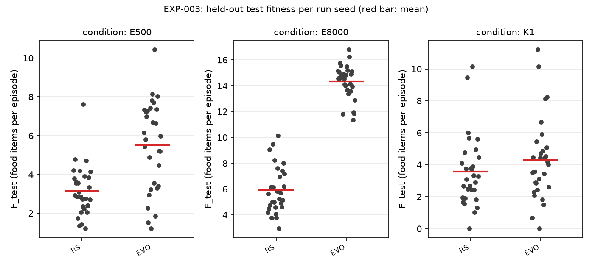
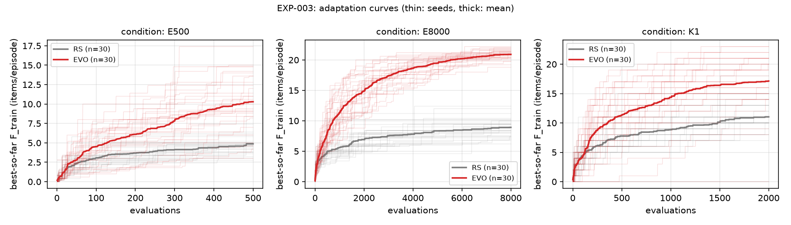
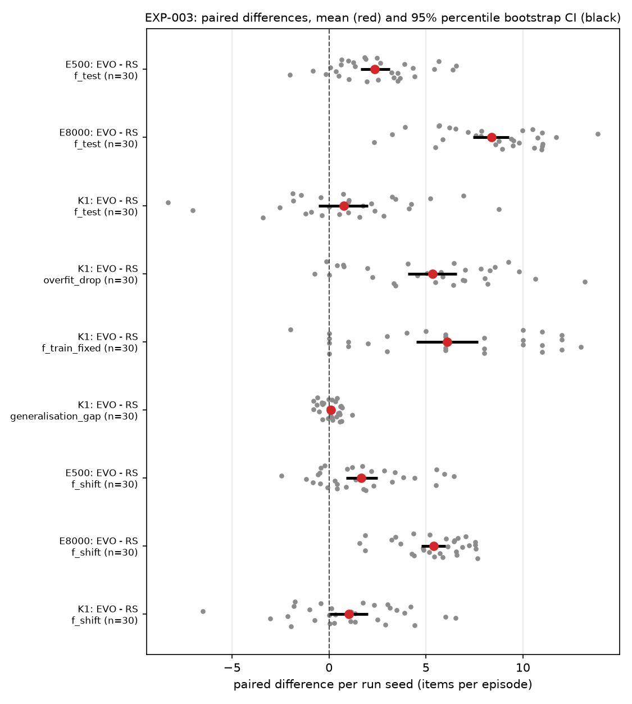

<!-- SPDX-License-Identifier: LicenseRef-EVOLVE-NC-Research-1.0 -->
# EXP-003 report: robustness to budget and training-set size

## 1. Identification

| Field | Value |
|---|---|
| Experiment | EXP-003 |
| Status | **Confirmatory, complete** (180 of 180 planned runs, 0 failed, 0 retried). Robustness hypothesis **not supported** (one condition inconclusive); not contradicted. |
| Date of runs | 2026-11-24T23:40:48Z to 2026-11-24T23:47:47Z (UTC; 2026-11-25 local time) |
| Report version | 1.0 (M3; written from the committed results after the owner's approval of 2026-11-25, D-012) |
| Authorship | Mohamed Bechir Kefi (approved C3, no affiliation). An AI system was used as a research and development assistant; it is not an author. |
| Protocol | `research/experiments/EXP-003/protocol.md` v1.0, SHA-256 4e4d36f307a2c68ffd74ede9de6d8fa311f83b3348d68a50529ba1499cc7e76a; main protocol SHA-256 3543a6fdf886c3c6fa0588344353eeb715e7706800884b165c2fe6378daa1e85 |
| Config | `experiments/configs/EXP-003.json`, file SHA-256 5ed71f8434acaefd82a8bfe8e414d84782e3b87771bee3946d464075aca253b8, canonical hash 81f9f93864d7bca4714d4ebed223a72ec7689467a274f3c7f13fa12e8586b542 |
| Provenance revision | 5d39c9bf1eae7356b1fa837642e02e4bde68e186 (clean tree) |
| Scope | Simulation of a synthetic grid world only. Not evidence about biological evolution or general intelligence. |

## 2. Executive summary

**Question.** Does the EVO minus RS difference in held-out test fitness keep its sign at E = 500 and E = 8,000, and when each evaluation uses one fixed training environment (K = 1) instead of five resampled ones?

**Method.** Three conditions (E500: P = 25, G = 20; E8000: P = 100, G = 80; K1: E = 2,000 with one fixed training environment) x 2 arms (RS, EVO) x 30 paired run seeds; paired percentile bootstrap per condition (10,000 resamples, analysis seed 0).

**Outcome.** EVO minus RS was positive at **E500, 2.368 [1.627, 3.128]**, and at **E8000, 8.374 [7.418, 9.287]**, but **inconclusive under K1: 0.751 [-0.533, 1.998]** (items per episode, 95 percent CI, n = 30). The robustness hypothesis (positive in every condition) is therefore **not supported**; no interval lies at or below 0, so it is **not contradicted**. Under K1, EVO's returned policies scored higher than RS's on the fixed training environment (6.100 [4.500, 7.700]) and lost more of it on the test set (overfit_drop EVO minus RS 5.349 [4.077, 6.582]).

**Principal caveat.** By protocol B.10 item 2, the main interpretation of EXP-001 ("selection improves held-out performance") depends on the training design (resampled environments) rather than on selection as such. Inconclusive is not equivalence.

## 3. Rationale and literature

Training on a fixed set of levels and testing on held-out levels exposes overfitting in reinforcement learning (Cobbe et al. 2019, arXiv:1912.01588). Conclusions from point estimates over few runs can change under interval estimation (Agarwal et al. 2021, arXiv:2108.13264); seed counts must be justified (Colas et al. 2018, arXiv:1806.08295). Gap: whether a selection advantage at one budget and training design survives other budgets and a fixed training environment, at the run level with paired seeds.

## 4. Hypotheses and operational definitions

- H1 (robustness): the paired difference EVO minus RS in F_test is positive in every condition. H0: in at least one condition it is at most 0. Contradicting result: any condition whose 95 percent interval lies at or below 0. Per condition: supported if the lower bound is above 0, inconclusive if the interval contains 0.
- K1: every evaluation uses training-pool environment 0 of the run seed (one episode per evaluation). `F_train_fixed` = items consumed by the returned policy on that environment (deterministic, one episode); `overfit_drop = F_train_fixed - F_test` (items per episode), the overfitting measure (amendment C.2). Both are null in E500 and E8000.
- The generalisation gap `F_train_fresh - F_test` is reported in every condition, but under K = 1 it is not the overfitting measure.
- Other definitions as EXP-001.

## 5. Methodology

As EXP-001 section 5 (policy, seeds 0 to 29, root seed 20261124, synthetic data, hardware, software, statistics). EVO: truncation keeps the top 20 percent, one elite, sigma 0.1 (E500: 5 of 25 parents; E8000: 20 of 100, as implemented and tested, D-009 item 5). RS: E independent draws. Analysis by `scripts/analyse_frozen.py`, committed before any confirmatory output; it computes the EVO minus RS F_test contrast per condition and, for K1, the paired `overfit_drop` contrast named in the estimand.

## 6. Implementation verification

- Test suite before the runs: 135 passed. Metric identities (`scripts/validate_results.py`, including the K = 1 null fields) on the 180 runs: 0 failures.
- The replay invariant was enforced in every simulated episode; no run aborted.

## 7. Execution record

- Command: `./scripts/run_confirmatory.sh EXP-003 2` (freeze guard passed; `nice -n 10`, 2 workers).
- Start 2026-11-24T23:40:48Z, end 23:47:47Z, matrix wall-clock 418.5 s, exit status 0. Load average 87.86 at start and 88.99 at end (shared machine, processes not started by this session).
- 180 planned, 180 ok, 0 failed, 0 retried, 0 dropped. Run ids `EXP-003.{E500,E8000,K1}.{RS,EVO}.s0000` to `.s0029`.
- Mean wall-clock per run (contended): E500 RS 1.162 s, EVO 1.095 s; E8000 RS 12.505 s, EVO 10.326 s; K1 RS 0.499 s, EVO 0.512 s.
- Deviations from the frozen protocol: none. The E8000 condition (first cut under B.12) was not cut.
- Owner decisions of 2026-11-25 (D-012) do not change this experiment's analysis or verdict.
- Disclosure (C4): the pilot (J-0004, exploratory pool) had shown EVO minus RS of 4.361 (E500), 8.801 (E8000) and 2.497 (K1) before the freeze.

## 8. Results

**TAB-1. Metrics by condition and arm (mean over 30 run seeds; items per episode).** Source: `results/confirmatory/EXP-003/report/summary.csv` and `report/report.md`.

| Condition | Arm | F_test mean (SD) | F_test min to max | F_train_fresh | F_shift | Gap | Training fitness of returned policy | Stay fraction |
|---|---|---|---|---|---|---|---|---|
| E500 | RS | 3.143 (1.287) | 1.220 to 7.615 | 3.188 | 2.376 | 0.044 | 4.873 | 0.152 |
| E500 | EVO | 5.511 (2.309) | 1.205 to 10.440 | 5.566 | 4.037 | 0.055 | 10.293 | 0.087 |
| E8000 | RS | 5.945 (1.792) | 2.940 to 10.140 | 5.885 | 4.228 | -0.061 | 8.920 | 0.094 |
| E8000 | EVO | 14.319 (1.315) | 11.365 to 16.805 | 14.510 | 9.629 | 0.191 | 20.913 | 0.010 |
| K1 | RS | 3.561 (2.227) | 0.000 to 10.140 | 3.510 | 2.387 | -0.051 | 11.033 | 0.151 |
| K1 | EVO | 4.312 (2.569) | 0.000 to 11.220 | 4.356 | 3.402 | 0.045 | 17.133 | 0.226 |

K = 1 overfitting measure (mean over 30 seeds): RS F_train_fixed 11.033, overfit_drop 7.472 (SD 2.370); EVO F_train_fixed 17.133, overfit_drop 12.821 (SD 4.023).

Reference condition (protocol section 17), EXP-001 at E = 2,000, K = 5: EVO minus RS 5.791 [4.644, 6.844].

**TAB-2. Paired contrasts EVO minus RS (n = 30 pairs per condition).** Source: `results/confirmatory/EXP-003/analysis/analysis.json`.

| Condition | Metric | Role | Mean diff | 95% CI | d_z [95% CI] | Seeds +/-/0 | Wilcoxon p | Reading |
|---|---|---|---|---|---|---|---|---|
| E500 | F_test | registered | **2.368** | **[1.627, 3.128]** | 1.11 [0.77, 1.61] | 27/3/0 | 1.8e-05 | supported |
| E8000 | F_test | registered | **8.374** | **[7.418, 9.287]** | 3.08 [2.42, 4.35] | 30/0/0 | 1.7e-06 | supported |
| K1 | F_test | registered | **0.751** | **[-0.533, 1.998]** | 0.21 [-0.14, 0.65] | 18/11/1 | 0.157 | **inconclusive** |
| K1 | overfit_drop | registered secondary | 5.349 | [4.077, 6.582] | 1.50 [1.12, 2.16] | 27/2/1 | 4.3e-06 | EVO overfits more (estimate) |
| K1 | F_train_fixed | descriptive | 6.100 | [4.500, 7.700] | 1.35 [1.00, 1.93] | 25/1/4 | 1.2e-05 | EVO higher on the fixed environment |
| K1 | generalisation gap | descriptive | 0.095 | [-0.080, 0.265] | 0.19 [-0.17, 0.59] | 17/12/1 | 0.294 | interval contains 0 (not the K = 1 overfitting measure) |
| E500 | F_shift | descriptive | 1.661 | [0.865, 2.496] | 0.72 [0.43, 1.10] | 21/9/0 | 0.0014 | interval above 0 |
| E8000 | F_shift | descriptive | 5.402 | [4.766, 6.009] | 3.06 [2.37, 4.49] | 30/0/0 | 1.7e-06 | interval above 0 |
| K1 | F_shift | descriptive | 1.015 | [0.035, 1.998] | 0.36 [0.01, 0.82] | 20/9/1 | 0.043 | interval above 0, near 0 |

*FIG-1.* Held-out test fitness of the returned policy per run seed, one panel per condition (n = 30 per arm and condition); red bar: mean. Unit: food items per episode.

*FIG-2.* Best-so-far training fitness against evaluations (thin: seeds, thick: mean; n = 30 per arm). Under K1, training fitness is measured on the single fixed environment, so the curves show fit to that environment, not held-out performance.

*FIG-3.* Paired differences per run seed (grey), mean (red) and 95 percent percentile bootstrap interval over run seeds (black, 10,000 resamples), n = 30 pairs per row. Dashed line: no difference.

Degenerate-case checks (`results/confirmatory/EXP-003/report/report.md`): two returned policies scored 0 on the test set, both K1 seed 13 (`EXP-003.K1.EVO.s0013`, `EXP-003.K1.RS.s0013`); seven returned policies stayed in place on more than half of the test steps (one E500 RS, four K1 EVO, two K1 RS); no run reached the 24-item ceiling; no final population had zero behavioural diversity.

## 9. Interpretation

**Expected versus observed.** Expected (H1): EVO above RS in every condition. Observed: above RS at E500 and E8000, inconclusive under K1. Verdict under the frozen rule: H1 not supported, not contradicted.

**Budget (B.10 item 1).** The EVO advantage did not disappear or reverse at E = 500 or E = 8,000; it was smaller at E500 (2.368) and larger at E8000 (8.374) than at the EXP-001 reference (5.791). Within the tested budgets the primary result is not budget-specific.

**Training design (B.10 item 2).** Under K = 1, EVO beat RS on the fixed training environment (F_train_fixed 6.100 [4.500, 7.700]) but not demonstrably on held-out environments (F_test 0.751 [-0.533, 1.998]), and its overfitting drop exceeded RS's by 5.349 [4.077, 6.582]. This is the pattern B.10 item 2 names: the interpretation "selection improves held-out performance" depends on the training design (resampled environments) rather than on selection as such. The fresh-environment gap stays near 0 under K1 because fresh training-pool environments are not the fixed environment, as the protocol anticipated.

**Shifted distribution.** EVO minus RS on F_shift is positive in all three conditions, with the K1 interval close to 0 ([0.035, 1.998]); descriptive only.

**Null result.** The K1 interval contains 0. This does not show that EVO and RS are equivalent under K = 1; the interval allows differences from about -0.5 to about 2.0 items.

**Model-dependent inference.** With one fixed environment, selection appears to fit that layout (protocol section 2 mechanism), which held-out fitness reveals. This is an interpretation, not a direct measurement.

## 10. Threats to validity

- **Statistical.** Three conditions interpreted jointly without multiplicity adjustment (frozen). The K1 result rests on n = 30; its SDs are the largest of the experiment, and one seed (13) produced F_test = 0 for both arms.
- **Construct.** F_train_fixed is one deterministic episode per run. Overfitting is measured against one environment per seed.
- **Internal.** Directions in all three conditions were seen on the exploratory pool before the freeze (C4).
- **External.** One task, one architecture; EVO hyperparameters scaled with budget as implemented (D-009 item 5), not tuned per budget.
- **Hardware.** Shared machine; wall-clock only.

## 11. Conclusion and next experiment

Within this simulation, EVO's held-out advantage over RS held at E = 500 (2.368 [1.627, 3.128]) and E = 8,000 (8.374 [7.418, 9.287]) but was inconclusive with one fixed training environment (0.751 [-0.533, 1.998]), where EVO overfit more than RS (overfit_drop difference 5.349 [4.077, 6.582]). The robustness hypothesis is not supported and the EXP-001 claim is restricted to resampled training. A follow-up, under a new EXP id, could vary K between 1 and 5 to locate where the advantage appears.

## 12. Reproduction appendix

- Dependencies and data: as EXP-001 (`uv.lock`; synthetic data, `data/manifest.json` SHA-256 0d1dad1989d1a6d8013a974902d831b570e9f121a622acd782367d501a230f99).
- Commands: `reproduction.md` in this folder.
- Raw results: `results/confirmatory/EXP-003/runs/` (180 files, schema `evolve.run_result` 1.1.0), `manifests/`, `matrix_manifest.json`, `run_provenance.json`, `run.log`; checksums in `results/confirmatory/EXP-003/sha256_manifest.json`.
- Tables and figures: `results/confirmatory/EXP-003/report/` and `analysis/analysis.json`; copies in this folder.
- References: `research/paper/references.bib`, verified in `research/literature_review.md`.
