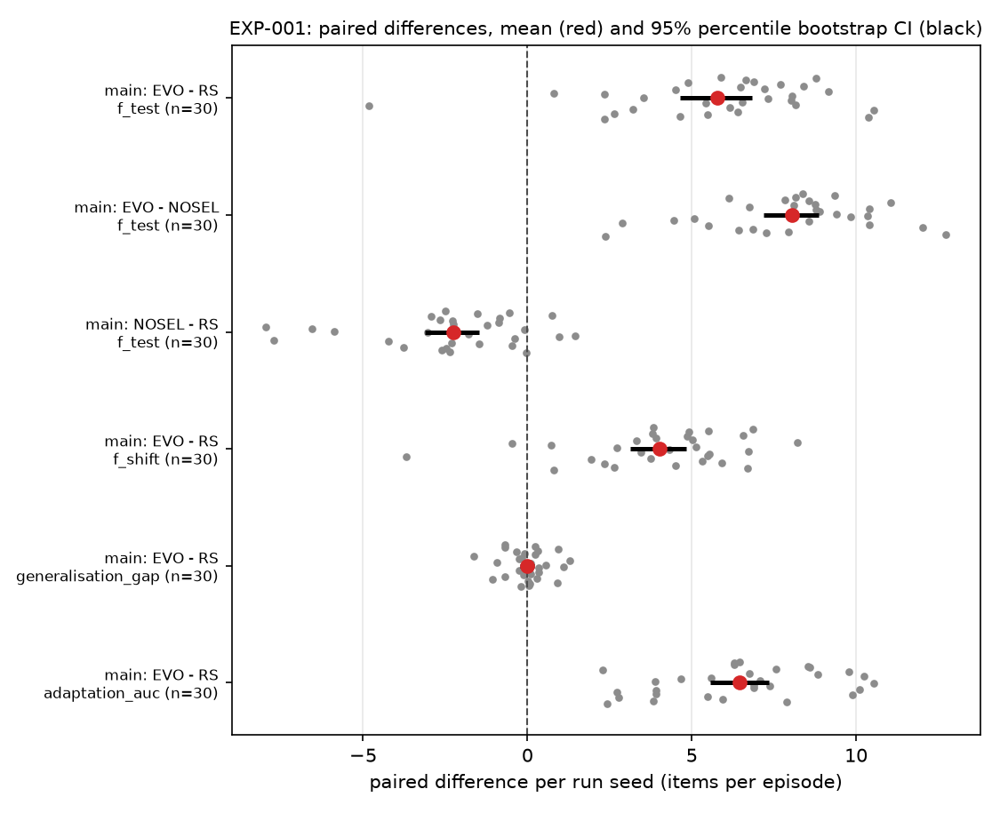
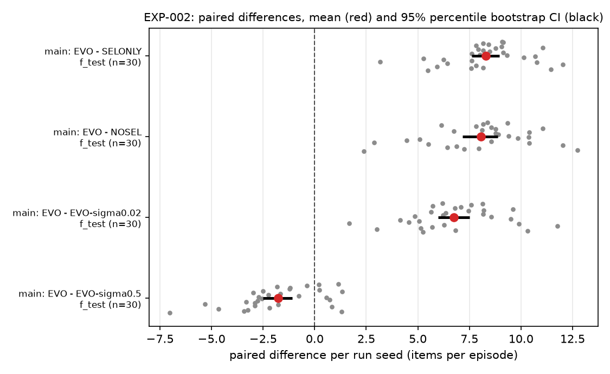
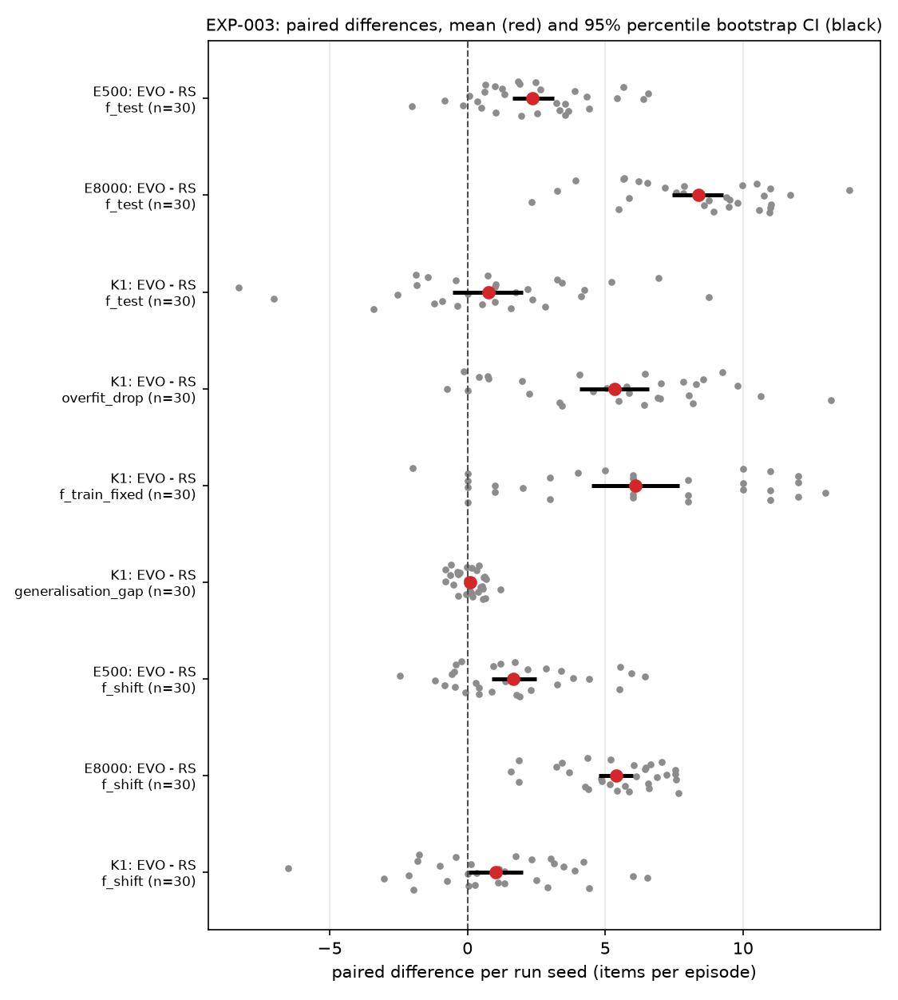

<!-- SPDX-License-Identifier: LicenseRef-EVOLVE-NC-Research-1.0 -->

**Status.** Independent research manuscript / preprint draft, not peer-reviewed. All results come from simulations of a synthetic grid world. Every number in this manuscript is taken from committed result files and is mapped to its source in `research/publication/artifact_manifest.json`.

# Abstract

Simple evolutionary algorithms and random search are both used as black-box methods for finding neural-network policies, and comparisons between them depend on budgets, seeds and evaluation details. We asked whether, at an equal budget of policy evaluations, evolutionary selection with inherited and mutated policies (EVO) returns foraging policies with higher fitness on held-out environments than independent random search (RS), and whether that advantage survives changes in budget, mutation strength and training design. In a synthetic 16 x 16 foraging grid we ran a protocol frozen before any confirmatory run: 420 runs over 30 paired run seeds, a no-selection control (NOSEL), a mutation ablation (SELONLY), two other mutation strengths, two other budgets and a single fixed training environment. At 2,000 evaluations EVO exceeded RS by 5.791 food items per episode (95 percent paired bootstrap CI [4.644, 6.844]), supporting the primary hypothesis. Removing selection or mutation lowered held-out fitness by about 8 items. The advantage over RS held at 500 and 8,000 evaluations, but with one fixed training environment it was inconclusive (0.751, CI [-0.533, 1.998]) while EVO overfit that environment more than RS. The frozen mutation strength of 0.1 was not the best tested: 0.5 exceeded it by 1.776 items. Within this simulation, selection with mutation outperformed independent sampling when training environments were resampled; the result is specific to that training design, says nothing about other local search methods, and does not concern biological evolution or general intelligence.

# Keywords

evolutionary algorithms; random search; neuroevolution; preregistration; generalisation; ablation

# 1. Introduction

Gradient-free search over the weights of a neural-network policy is a practical alternative to gradient-based reinforcement learning in some settings. A simple population-based genetic algorithm has been reported to be competitive on deep reinforcement learning tasks (Such et al. 2017), and evolution strategies have been presented as a scalable black-box alternative (Salimans et al. 2017). At the same time, random search is a natural baseline for adaptive search methods (Bergstra and Bengio 2012), a random search method has been reported to be competitive for training static linear policies (Mania et al. 2018), and results in this area vary with seeds and evaluation details (Henderson et al. 2017; Colas et al. 2018; Agarwal et al. 2021). A claim that selection helps therefore needs a comparison with random search at an equal budget, a control that removes selection while keeping everything else, held-out evaluation and run-level uncertainty.

This study asks a narrow question in a fully synthetic setting: within a fixed budget of policy evaluations, does evolutionary selection with inherited, mutated policies find foraging policies with higher fitness on held-out grid environments than independent random search, and does any advantage survive changes in budget, mutation strength and training-set size?

The study makes four contributions, each limited to the simulation described in Section 3.

1. A preregistered paired comparison of EVO, RS and a no-selection control at an equal budget of 2,000 evaluations, with 30 paired run seeds and a shared held-out test set (EXP-001).
2. Ablations that remove mutation or selection and vary the mutation strength (EXP-002), including a result that contradicts the protocol's assumption about the primary mutation strength.
3. A sensitivity analysis designed in advance to be able to restrict or overturn the main interpretation (EXP-003), which did restrict it.
4. A complete evidence trail: frozen protocols with SHA-256 hashes, raw per-run outputs, run-time provenance, a frozen analysis script committed before any confirmatory output, standalone experiment reports and a number-level audit.

No novelty claim is made beyond this reproducible and transparently reported design.

# 2. Related work

The literature review is targeted, not systematic (`research/literature_review.md`). In M4 only the abstracts or landing pages were read. In M6 (2026-11-25) the free full text of each cited paper (arXiv or the publisher's open-access PDF) was consulted for the passage that supports each citing sentence; the papers were not read cover to cover, and the blog post was read in full. The passages are listed in `research/literature_review.md`.

**Evolutionary search on network weights.** Such et al. (2017) evolve the weights of deep networks with a simple, gradient-free, population-based genetic algorithm and report competitive results on hard deep reinforcement learning tasks. Salimans et al. (2017) present evolution strategies as an alternative to Markov-decision-process-based reinforcement learning that scales with the number of CPUs. The genetic algorithm of Such et al. uses truncation selection, additive Gaussian mutation, one elite and no crossover (their Section 3). The EVO arm uses the same kinds of operators with this project's own population size, truncation size, mutation strength and elite evaluation; it is not a replication of either paper.

**Random search as a baseline.** Bergstra and Bengio (2012) argue that random search is a natural baseline against which adaptive hyperparameter optimisation methods should be judged. Mania et al. (2018) introduce a random search method for static linear policies in continuous control and report large performance variability across seeds and hyperparameters. The RS arm here is independent sampling from the initial distribution; it is the simplest baseline and is not a replication of the method of Mania et al.

**Evaluation practice.** Henderson et al. (2017) report that reproducing deep reinforcement learning results is difficult because of environment randomness and variance intrinsic to the methods, and call for significance metrics and stricter reporting. Colas et al. (2018) relate the number of random seeds to statistical error rates for the t-test and the bootstrap confidence interval test. Agarwal et al. (2021) advocate interval estimates of aggregate performance when only a few runs are available. These sources motivate the paired seeds, the fixed seed count and the interval-based decision rule used here.

**Generalisation and specification gaming.** Cobbe et al. (2019) use procedurally generated environments to measure generalisation in reinforcement learning; the disjoint training and test seed pools used here follow that general idea, but the split itself is this project's design. Lehman et al. (2018) collect cases in which digital evolution subverted its designers' intentions or exploited bugs, and Krakovna et al. (2020) define specification gaming as behaviour that satisfies the literal specification of an objective without achieving the intended outcome. These sources motivate the exploit audit.

**Position of this study.** The study is an extension in a new, small setting, not a replication: it tests, under a frozen protocol, whether the selection step of a simple genetic algorithm adds held-out value over independent sampling and over mutation without selection.

# 3. Background and formal model

**Environment.** A 16 x 16 toroidal grid holds `n_food = 24` food items on distinct cells, clustered around 3 centres, generated from an environment seed. The agent starts at the centre with a random heading. An episode lasts `T = 100` steps. The observation is a 5 x 5 egocentric window rotated to the heading (24 food indicators, own cell excluded) plus a constant bias input. Actions are forward, turn left, turn right and stay; moving onto food consumes it.

**Policy.** A deterministic feed-forward network with 25 inputs, 8 tanh hidden units and 4 outputs, with argmax action selection. The parameter vector `theta` has 236 components; initial parameters are drawn from `N(0, 1)` per component.

**Fitness.** The episode fitness `f(theta, e)` is the number of food items consumed in environment `e`, in `[0, 24]`. Training fitness is `F_train(theta) = (1/K) sum_k f(theta, e_k)`, with `K = 5` environments drawn from the training seed pool at each evaluation. The primary metric is held-out test fitness

`F_test(theta) = (1/M) sum_m f(theta, e_m)`, with `M = 200` fixed environments from a test pool disjoint from the training pool,

in food items per episode. One evaluation scores one policy on K training episodes. Every arm returns the evaluated policy with the highest training fitness, and only that policy is scored on the test set.

**Estimand.** For run seed `s`, `d_s = F_test(EVO, s) - F_test(RS, s)`, and `delta = E_s[d_s]`. H0: `delta <= 0`; H1: `delta > 0`.

**Secondary quantities.** The re-measured generalisation gap is `F_train_fresh - F_test`, where `F_train_fresh` uses 200 fresh training-pool environments. Shifted fitness `F_shift` uses 200 environments from a different generator (uniform placement, 16 items). Under the K = 1 condition the overfitting measure is `overfit_drop = F_train_fixed - F_test`, where `F_train_fixed` is the returned policy's score on the single fixed training environment. The adaptation AUC is the best-so-far training fitness averaged over evaluations. The exploit audit records the fraction of steps spent on `stay` and checks in every episode that the consumed count equals the decrease in food on the grid.

**Complexity.** A run costs `E x K x T` environment steps for search (one million at E = 2,000, K = 5), plus 600 evaluation episodes for the returned policy.

# 4. Methods

## 4.1 Design and protocol registration

The main protocol (`research/protocol.md`, v1.0) and three experiment protocols were frozen by the owner on 2026-11-24, before any confirmatory run, with six amendments made in response to an exploratory pilot (Part C of the protocol; decision record D-010). The SHA-256 of the main protocol, the three experiment protocols and the three confirmatory configs are stored in `research/freeze.json`, and the run command refuses a confirmatory run if any hash differs. The analysis script (`scripts/analyse_frozen.py`) was committed before any confirmatory output existed (D-011, revision 5d39c9b).

## 4.2 Environments and data

No external data are used (D-002). All environments are generated from recorded seeds. `numpy.random.SeedSequence` spawn keys separate the search stream and the training, test and shifted environment pools; tests check that the pools are disjoint and that no test layout appears among training layouts. Exploratory runs used a separate test pool and run seeds of 1000 and above, and never touched the confirmatory pools or seeds (D-006).

## 4.3 Arms, controls and baselines

| Arm | Definition | Role |
|---|---|---|
| RS | 2,000 independent draws `theta ~ N(0, 1)` | primary baseline |
| EVO | population 50, 40 generations, truncation selection (top 10 parents), one elite copied and re-evaluated, Gaussian mutation `sigma = 0.1` | treatment |
| NOSEL | as EVO, with parents and copied individual chosen uniformly at random | no-selection control |
| SELONLY | as EVO with `sigma = 0` | mutation ablation |
| EVO-sigma0.02, EVO-sigma0.5 | EVO with `sigma` 0.02 or 0.5 | mutation-strength sweep |

Generation 0 of every population arm equals the first 50 RS draws of the same run seed, and mutation noise is shared across population arms of a run seed. All arms share the budget, the output-selection rule, the architecture and the test set. Before any confirmatory run, NOSEL was predeclared to score below RS (amendment C.3), because a neutral random walk around 50 starting points explores less than 2,000 independent draws; NOSEL is a control for selection, not a competitor to RS.

## 4.4 Experiments

| Experiment | Conditions | Arms | Runs |
|---|---|---|---|
| EXP-001 (primary) | E = 2,000, K = 5 | RS, NOSEL, EVO | 90 |
| EXP-002 (ablations) | E = 2,000, K = 5 | EVO, NOSEL, SELONLY, EVO-sigma0.02, EVO-sigma0.5 | 150 (60 bit-identical to EXP-001) |
| EXP-003 (sensitivity) | E = 500 (P = 25, G = 20); E = 8,000 (P = 100, G = 80); K1: E = 2,000 with one fixed training environment | RS, EVO | 180 |

The parent and elite counts in the E500 and E8000 conditions scale with the population as implemented and pinned by tests (D-009 item 5); they were not tuned per budget.

## 4.5 Implementation and verification

The engine is NumPy code in `src/evolve/`. Before the confirmatory runs the test suite passed 135 tests, covering mutation bounds, golden fitness scoring with a hand-built policy, the batched engine against a scalar reference, determinism across processes, seed-pool disjointness, the freeze guard, the command-line interface and the analysis script. A results validator checks 11 identities per run (for example, F_test recomputed from stored episodes, evaluation counts and score bounds); it found 0 failures on all 420 confirmatory runs. The replay invariant passed in all 420 runs.

## 4.6 Seeds and resource budget

Each experiment used run seeds 0 to 29 under one root seed, paired across arms. With 30 pairs a paired two-sided test at alpha 0.05 and 80 percent power detects a standardised effect of about `d_z = 0.53` (planning approximation, protocol B.6). The runs used an Apple M1 Pro (10 cores), macOS 15.3.1, Python 3.12.1 and NumPy 2.5.4, with 2 worker processes at reduced priority. The three matrices took 105.3 s, 344.4 s and 418.5 s of wall-clock. The machine was shared with other workloads (load average rising from 6.19 to 88.99), so timings are informational; results are deterministic. No paid service was used.

## 4.7 Statistical analysis

The unit of analysis is the run seed; episodes are averaged within a run. For each contrast we report the mean paired difference with a 95 percent percentile bootstrap interval over run seeds (10,000 resamples, analysis seed 0), `d_z` with its bootstrap interval, the counts of positive and negative seeds, and a Wilcoxon signed-rank test as a robustness check only. The frozen decision rule is: supported if the lower bound is above 0, contradicted if the upper bound is at or below 0, and inconclusive otherwise, which is never read as equivalence. Secondary contrasts are estimates without a significance claim; no multiplicity adjustment was frozen.

## 4.8 Exploratory versus confirmatory work

Confirmatory: the 420 runs of EXP-001 to EXP-003 and the frozen analysis. Exploratory: the smoke matrices (J-0003, J-0007), the pilot at full settings on the exploratory pool (J-0004, 10 seeds), the determinism check (J-0005) and the M4 sensitivity re-analysis of committed results (J-0012). The pilot had shown the same direction as the confirmatory results for the primary contrast (EVO minus RS 7.923 items, CI [6.462, 9.529]), for the sigma 0.5 contrast and for the budget conditions; this is disclosed in the freeze record (C4). The pilot informed amendments C.1 to C.3; sigma was kept at 0.1 despite the pilot (C.4).

# 5. Results

All 420 planned confirmatory runs completed with status ok; none failed, was retried or was dropped, and no deviation from the frozen protocol occurred.

## 5.1 EXP-001: selection versus random search (primary)

**Table 1.** Held-out test fitness and secondary metrics at E = 2,000, K = 5 (mean over 30 run seeds; food items per episode). Source: `results/confirmatory/EXP-001/report/summary.csv`.

| Arm | F_test mean (SD) | F_shift | Training fitness of returned policy | Stay fraction |
|---|---|---|---|---|
| RS | 4.728 (1.897) | 3.462 | 6.920 | 0.149 |
| NOSEL | 2.474 (1.193) | 1.850 | 4.940 | 0.270 |
| EVO | 10.520 (2.018) | 7.481 | 16.960 | 0.025 |

**Table 2.** Paired contrasts at E = 2,000 (n = 30 pairs). Source: `results/confirmatory/EXP-001/analysis/analysis.json`.

| Contrast | Metric | Mean difference | 95% CI | d_z | Seeds + / - | Reading |
|---|---|---|---|---|---|---|
| EVO - RS | F_test | 5.791 | [4.644, 6.844] | 1.85 | 29 / 1 | H1 supported (frozen rule) |
| EVO - NOSEL | F_test | 8.046 | [7.173, 8.874] | 3.33 | 30 / 0 | interval above 0 (secondary) |
| NOSEL - RS | F_test | -2.255 | [-3.110, -1.476] | -0.96 | 3 / 27 | below 0, as predeclared |
| EVO - RS | F_shift | 4.020 | [3.138, 4.845] | 1.63 | 28 / 2 | interval above 0 (descriptive) |
| EVO - RS | generalisation gap | -0.006 | [-0.229, 0.216] | -0.01 | 17 / 13 | contains 0 (descriptive) |

EVO returned policies with higher held-out fitness than RS in 29 of 30 paired seeds, and H1 is supported under the frozen rule (Figure 1). The Wilcoxon check agreed (p = 4.3e-06). NOSEL scored below RS, as predeclared, and EVO exceeded NOSEL in every seed. The advantage carried over to the shifted distribution, which was never used for any choice. The re-measured generalisation gap did not differ between EVO and RS. The returned policies' training fitness overstated their held-out fitness in every arm (winner's curse), but the test set is fresh and shared, so this bias does not favour one arm in the primary metric.

*Figure 1 (EXP-001 FIG-3).* Paired differences per run seed (grey points), mean (red) and 95 percent percentile bootstrap interval over run seeds (black bar, 10,000 resamples), n = 30 pairs per row. Dashed line: no difference.

## 5.2 EXP-002: ablations of mutation and selection

**Table 3.** EVO (sigma 0.1) minus each ablation on F_test (n = 30 pairs). Arm means in items per episode: EVO 10.520, NOSEL 2.474, SELONLY 2.223, EVO-sigma0.02 3.770, EVO-sigma0.5 12.296. Source: `results/confirmatory/EXP-002/analysis/analysis.json` and `report/summary.csv`.

| Contrast | Hypothesis | Mean difference | 95% CI | d_z | Seeds + / - | Reading |
|---|---|---|---|---|---|---|
| EVO - SELONLY | H1a | 8.297 | [7.608, 8.956] | 4.27 | 30 / 0 | supported (estimate) |
| EVO - NOSEL | H1b | 8.046 | [7.173, 8.874] | 3.33 | 30 / 0 | supported (estimate) |
| EVO - EVO-sigma0.02 | sweep | 6.749 | [5.982, 7.513] | 3.06 | 30 / 0 | sigma 0.02 below 0.1 |
| EVO - EVO-sigma0.5 | sweep | -1.776 | [-2.519, -1.082] | -0.87 | 8 / 22 | contradicting result under EXP-002's rule |

Removing either mutation or selection lowered held-out fitness by about 8 items per episode (Figure 2). The mean F_test of both ablations was also below the RS mean of EXP-001 (4.728), a comparison of means across experiments that share seeds and test set, for which no paired contrast was registered. Mean F_test rose from sigma 0.02 to 0.1 to 0.5. The interval for EVO minus EVO-sigma0.5 lies entirely below 0. The owner classified this as a contradicting result under EXP-002's rule, a finding against EXP-002's assumption about the setting, and decided that H1 of EXP-001 stands (owner decision of 2026-11-25, D-012). EVO-sigma0.5 also had the largest genotypic diversity of the final population (23.90 against 5.01 for sigma 0.1).

*Figure 2 (EXP-002 FIG-3).* Paired differences EVO (sigma 0.1) minus each other arm per run seed (grey), mean (red) and 95 percent percentile bootstrap interval (black, 10,000 resamples), n = 30 pairs per row.

## 5.3 EXP-003: budget and training-design sensitivity

**Table 4.** EVO minus RS per condition (n = 30 pairs per condition). Source: `results/confirmatory/EXP-003/analysis/analysis.json`.

| Condition | Metric | RS mean | EVO mean | Mean difference | 95% CI | Seeds + / - / 0 | Reading |
|---|---|---|---|---|---|---|---|
| E500 | F_test | 3.143 | 5.511 | 2.368 | [1.627, 3.128] | 27 / 3 / 0 | above 0 |
| E2000 (EXP-001 reference) | F_test | 4.728 | 10.520 | 5.791 | [4.644, 6.844] | 29 / 1 / 0 | above 0 |
| E8000 | F_test | 5.945 | 14.319 | 8.374 | [7.418, 9.287] | 30 / 0 / 0 | above 0 |
| K1 | F_test | 3.561 | 4.312 | 0.751 | [-0.533, 1.998] | 18 / 11 / 1 | inconclusive |
| K1 | F_train_fixed | 11.033 | 17.133 | 6.100 | [4.500, 7.700] | 25 / 1 / 4 | above 0 (descriptive) |
| K1 | overfit_drop | 7.472 | 12.821 | 5.349 | [4.077, 6.582] | 27 / 2 / 1 | EVO overfits more (estimate) |

The EVO advantage did not disappear or reverse at E = 500 or E = 8,000, and the difference was larger at larger budgets (Figure 3). Population size and generation count were scaled together with the budget, so this trend is not an effect of the budget alone. With one fixed training environment, EVO's returned policies scored higher than RS's on that environment but not demonstrably on held-out environments, and they lost more of their training score on the test set. The robustness hypothesis of EXP-003 (positive in every condition) is therefore not supported, and, because no interval lies at or below 0, it is not contradicted. Under protocol B.10 item 2 this is the pattern that makes the main interpretation depend on the training design. Two returned policies, both from K1 seed 13, scored 0 on the test set.

*Figure 3 (EXP-003 FIG-3).* Paired differences EVO minus RS per run seed (grey), mean (red) and 95 percent percentile bootstrap interval (black, 10,000 resamples), n = 30 pairs per row, for each condition and metric. Dashed line: no difference.

## 5.4 Exploit audit

The replay invariant held in every episode of all 420 runs. EVO policies stayed in place on 2.5 percent of test steps on average at E = 2,000 (Table 1). Across the three experiments, 18 distinct returned policies stayed in place on more than half of their test steps; none was an EVO policy trained with K = 5 (7 NOSEL and 1 RS in EXP-001; 3 SELONLY in EXP-002, whose 7 NOSEL cases are the same runs as in EXP-001; 1 RS at E500, and 4 EVO and 2 RS under K1 in EXP-003). No run reached the 24-item ceiling. The audit flags no scoring exploit behind the EVO advantage.

## 5.5 Robustness of the readings (exploratory)

An exploratory re-analysis of the committed results (J-0012, `results/exploratory/m4-sensitivity-2026-11-25/sensitivity.json`) checked whether any reading depends on the interval method, on multiplicity or on single seeds. It does not replace any frozen verdict. With Bonferroni-adjusted bootstrap levels (98.75 percent for the four EXP-002 contrasts, 98.33 percent for the three EXP-003 conditions), every registered reading was unchanged; the sigma 0.5 interval became [-2.706, -0.932] and the K1 interval [-0.779, 2.298]. Student t intervals agreed with the bootstrap readings in every case. No leave-one-seed-out subset changed any reading. Excluding K1 seed 13 left K1 inconclusive (0.777, CI [-0.544, 2.053], n = 29). Elite re-evaluations are 39 of the 2,000 evaluations of every population arm, and the returned EVO policy was an elite re-evaluation in 2 of 30 runs.

# 6. Discussion

**Expected versus observed.** Table 5 compares every registered prediction with the observation and the verdict under the frozen rule.

**Table 5.** Expected versus observed (all n = 30 pairs; items per episode).

| Experiment | Prediction (frozen) | Observation | Verdict under the frozen rule |
|---|---|---|---|
| EXP-001 | H1: EVO - RS > 0 | 5.791 [4.644, 6.844] | supported |
| EXP-001 | NOSEL below RS (predeclared expectation, informed by the pilot) | -2.255 [-3.110, -1.476] | as expected |
| EXP-002 | H1a: EVO > SELONLY | 8.297 [7.608, 8.956] | supported (estimate) |
| EXP-002 | H1b: EVO > NOSEL | 8.046 [7.173, 8.874] | supported (estimate) |
| EXP-002 | sigma 0.1 as the primary setting (assumption) | EVO - EVO-sigma0.5 = -1.776 [-2.519, -1.082] | contradicting result for the assumption (owner, D-012) |
| EXP-002 | sigma sweep, sigma 0.02 (estimand, no direction) | EVO - EVO-sigma0.02 = 6.749 [5.982, 7.513] | estimate |
| EXP-003 | EVO - RS > 0 at E500 | 2.368 [1.627, 3.128] | positive |
| EXP-003 | EVO - RS > 0 at E8000 | 8.374 [7.418, 9.287] | positive |
| EXP-003 | EVO - RS > 0 under K1 | 0.751 [-0.533, 1.998] | inconclusive |
| EXP-003 | Robustness (positive in every condition) | one condition inconclusive | not supported, not contradicted |

**Competing explanations.** The protocol named five competing explanations for the primary result. (a) *Local mutation search without selection.* NOSEL, with the same mutation and budget but no selection, fell 8.046 items below EVO, so mutation from 50 starting points without selection does not explain the advantage. (b) *Overfitting to the training environments.* With K = 5 resampled environments, the re-measured generalisation gap did not differ between arms and EVO also led on the shifted distribution; but under K = 1 EVO overfit more than RS and its held-out advantage became inconclusive. This explanation is therefore excluded for resampled training only. (c) *Scoring exploit.* The audit found none. (d) *Winner's curse.* All arms share the output rule and the test set is fresh; the bias is present in every arm's training fitness but not in the primary metric. (e) *NOSEL as a strawman.* NOSEL was predeclared to fall below RS, and the primary contrast is EVO minus RS, not EVO minus NOSEL. EXP-002 named two further explanations. Elite re-evaluation accounts for 1.95 percent of the budget, SELONLY also keeps an elite, and the returned EVO policy was an elite re-evaluation in only 2 of 30 runs; this argues against, but does not test, elite re-evaluation as the source of an 8-item effect. Whether the best mutation strength is an artefact of the fixed budget is not addressed: the sweep was run at E = 2,000 only. EXP-003 named budget dependence (no sign change was found within 500 to 8,000 evaluations) and overfitting under K = 1 (found).

**Mechanism.** The ablations show that neither component alone reproduces the EVO result: selection without mutation can only return one of its 50 starting policies, and mutation without selection is a random walk. The pattern is consistent with the protocol's proposed mechanism, that fitness is locally correlated in parameter space so that offspring of selected parents concentrate the budget in productive regions. This is an inference from the design, not a direct measurement of the fitness landscape. A plausible reading of the K1 result, also not directly measured, is the other side of the same mechanism: when the training signal is a single layout, selection concentrates the budget on fitting that layout. An alternative reading is that resampling five environments per evaluation makes the training signal noisy and varied, and that this, rather than selection as such, is what makes selected policies transfer; the design cannot separate the two, because selection was always paired with one training design per condition.

**What the comparator does not show.** RS is independent sampling from the initial distribution. EVO differs from it in two ways at once: it searches locally around good policies, and it does so with a population under truncation selection. NOSEL removes selection but keeps a population random walk, and SELONLY removes local steps. No arm isolates a single-lineage local search that keeps the best policy found (a hill climber or a local random search). The results therefore show that this genetic algorithm beats independent sampling, not that population-based selection beats local search in general.

**Mutation strength.** The frozen sigma 0.1 was kept as the primary setting before the confirmatory runs, although the pilot had shown sigma 0.5 ahead, to avoid tuning on seen data (amendment C.4). The confirmatory sweep reproduced the pilot ordering. The EXP-001 effect size is therefore not an upper bound for this genetic algorithm in this task, and whether sigma 0.5 is near an optimum is not known from three levels.

**Relation to prior work.** The direction agrees with reports that simple genetic algorithms are competitive black-box optimisers (Such et al. 2017). The comparison does not bear on the random search method of Mania et al. (2018) for static linear policies: that method updates a policy by steps along random directions (their Algorithm 1), whereas the RS arm here samples independently from the initial distribution. The K1 result is in line with the general motivation for procedurally generated training distributions (Cobbe et al. 2019).

**Practical significance.** Within the task, EVO at E = 2,000 collected about 10.5 of 24 available items per episode against about 4.7 for RS, and about 14.3 at E = 8,000. These are levels in a toy task chosen for reproducibility, not performance targets.

# 7. Limitations and threats to validity

- **Simulation only.** All environments and agents are synthetic. Improved task fitness is not general intelligence and is not evidence about biological evolution.
- **One environment family, one architecture, fixed hyperparameters.** External validity beyond the 16 x 16 clustered foraging grid and the 236-parameter network is not tested. The population size, generation count and truncation size were fixed; the optional truncation-size test has no frozen config and was not run.
- **Training-design dependence.** The advantage is established for K = 5 resampled training environments and was inconclusive for K = 1. Intermediate values of K were not tested.
- **The baseline is independent sampling.** RS draws from the initial distribution and is not tuned. Conclusions do not extend to local or tuned random search methods, and no arm isolates single-lineage local search from population-based selection.
- **Predeclarations informed by the pilot.** The NOSEL expectation (C.3) and the seed count (C.1) were set after the exploratory pilot; they are not independent predictions.
- **Primary sigma not the best tested.** The EXP-001 effect is specific to sigma 0.1.
- **Directions seen before the freeze.** The exploratory pilot, on separate pools and seeds, showed the same directions; the confirmatory pools and seeds were not used before the freeze (C4).
- **Multiplicity.** Four EXP-002 contrasts and three EXP-003 conditions were interpreted without adjustment, as frozen; the exploratory Bonferroni check did not change any reading.
- **Statistical.** n = 30 run seeds per arm, percentile bootstrap without small-sample correction; an inconclusive interval is not equivalence. F_train_fixed is one deterministic episode per run.
- **Budget accounting.** Budgets count policy evaluations; a different accounting such as environment steps or wall-clock could change comparisons with methods that evaluate differently.
- **Shared machine.** Wall-clock timings were taken under contention and are informational only.
- **Literature.** The review is targeted, not systematic; full texts were consulted only for the passages that support the citing sentences.

# 8. Ethics and responsible research

The study uses no human participants, no personal data and no external dataset; all environments are synthetic and generated from recorded seeds. No ethics approval was required and none is claimed. Findings concern a toy optimisation task and must not be presented as evidence about biological evolution, about general intelligence, or about any real-world system. The exploit audit was included because evolutionary search is known to exploit unintended scoring routes (Lehman et al. 2018; Krakovna et al. 2020).

# 9. Conclusion and future work

Within this simulation, at an equal budget of 2,000 policy evaluations with five resampled training environments per evaluation, a simple genetic algorithm returned foraging policies with higher held-out fitness than independent random search (5.791 items per episode, 95 percent CI [4.644, 6.844], n = 30 paired seeds). Removing selection or mutation removed the advantage, and the advantage grew with the budget between 500 and 8,000 evaluations. With a single fixed training environment the advantage was inconclusive and EVO overfit that environment more than RS, so the result depends on resampled training. The frozen mutation strength was not the best one tested. The study does not show that population-based selection beats local search methods in general. Feasible follow-ups, each under a new experiment id and a new frozen protocol, are: varying K between 1 and 5, a finer mutation-strength sweep with tuning on training-pool environments only, a comparison with a tuned local random search or a single-lineage hill climber at the same budget, and a second environment family.

# 10. Data and code availability

All code, configurations, frozen protocols, raw per-run results and analysis outputs are in this repository: `src/evolve/` (engine), `experiments/configs/` (frozen configs), `research/protocol.md` and `research/experiments/EXP-NNN/` (protocols, reports, copies of tables and figures), `results/confirmatory/EXP-NNN/` (raw runs, manifests, provenance, frozen analysis) and `research/publication/` (artifact manifest, audits). A confirmatory matrix is reproduced with `./scripts/evolve run --config experiments/configs/EXP-NNN.json`, the report with `./scripts/evolve report --results results/confirmatory/EXP-NNN` and the frozen analysis with `.venv/bin/python scripts/analyse_frozen.py EXP-NNN`. Public repository URL: [placeholder, not published; release requires the owner's approval].

# 11. Funding, competing interests and AI assistance

Funding: none declared [to be confirmed by the owner]. Competing interests: none declared [to be confirmed by the owner]. AI assistance: an AI system (Claude, Anthropic) was used as a research and development assistant for code, tests, protocol drafting, analysis scripts, reports and this manuscript, under the author's direction. The author approved the protocol freeze, the amendments and every post-run classification (D-010, D-012). Every number was checked against committed result files by a scripted audit (`scripts/audit_numbers.py`). The AI system is not an author, and its review passes are internal quality control, not peer review.

# References

Agarwal, R., Schwarzer, M., Castro, P. S., Courville, A., and Bellemare, M. G. (2021). Deep Reinforcement Learning at the Edge of the Statistical Precipice. arXiv:2108.13264. https://arxiv.org/abs/2108.13264 (full text consulted for the cited passage).

Bergstra, J., and Bengio, Y. (2012). Random Search for Hyper-Parameter Optimization. Journal of Machine Learning Research 13(10):281-305. https://www.jmlr.org/papers/v13/bergstra12a.html (full text consulted for the cited passage).

Cobbe, K., Hesse, C., Hilton, J., and Schulman, J. (2019). Leveraging Procedural Generation to Benchmark Reinforcement Learning. arXiv:1912.01588. https://arxiv.org/abs/1912.01588 (full text consulted for the cited passage).

Colas, C., Sigaud, O., and Oudeyer, P.-Y. (2018). How Many Random Seeds? Statistical Power Analysis in Deep Reinforcement Learning Experiments. arXiv:1806.08295. https://arxiv.org/abs/1806.08295 (full text consulted for the cited passage).

Henderson, P., Islam, R., Bachman, P., Pineau, J., Precup, D., and Meger, D. (2017). Deep Reinforcement Learning that Matters. arXiv:1709.06560. https://arxiv.org/abs/1709.06560 (full text consulted for the cited passage).

Krakovna, V., Uesato, J., Mikulik, V., Rahtz, M., Everitt, T., Kumar, R., Kenton, Z., Leike, J., and Legg, S. (2020). Specification gaming: the flip side of AI ingenuity. DeepMind blog, 21 April 2020. https://deepmind.google/discover/blog/specification-gaming-the-flip-side-of-ai-ingenuity/ (page read).

Lehman, J., Clune, J., Misevic, D., and others (2018). The Surprising Creativity of Digital Evolution: A Collection of Anecdotes from the Evolutionary Computation and Artificial Life Research Communities. arXiv:1803.03453. https://arxiv.org/abs/1803.03453 (full text consulted for the cited passage).

Mania, H., Guy, A., and Recht, B. (2018). Simple random search provides a competitive approach to reinforcement learning. arXiv:1803.07055. https://arxiv.org/abs/1803.07055 (full text consulted for the cited passage).

Salimans, T., Ho, J., Chen, X., Sidor, S., and Sutskever, I. (2017). Evolution Strategies as a Scalable Alternative to Reinforcement Learning. arXiv:1703.03864. https://arxiv.org/abs/1703.03864 (full text consulted for the cited passage).

Such, F. P., Madhavan, V., Conti, E., Lehman, J., Stanley, K. O., and Clune, J. (2017). Deep Neuroevolution: Genetic Algorithms Are a Competitive Alternative for Training Deep Neural Networks for Reinforcement Learning. arXiv:1712.06567. https://arxiv.org/abs/1712.06567 (full text consulted for the cited passage).

# Supplementary appendix

The complete experimental matrix, extended tables, configurations, robustness results, report links and the list of deviations and owner decisions are in `research/paper/supplementary.md`.
