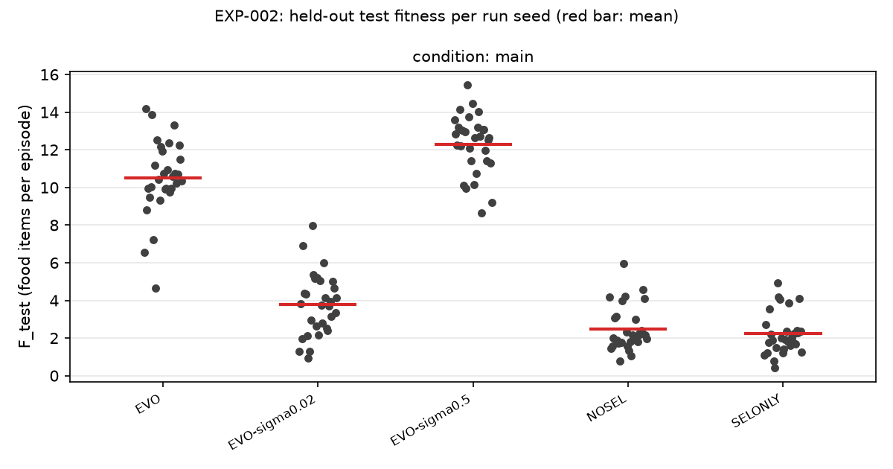
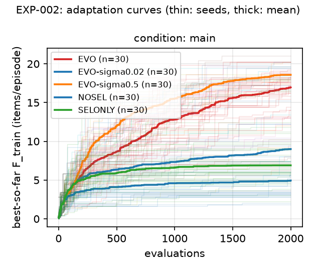

<!-- SPDX-License-Identifier: LicenseRef-EVOLVE-NC-Research-1.0 -->
# EVOLVE run report: EXP-002

Generated 2026-11-24T23:40:56.017657Z by `src/evolve/report.py` from `results/confirmatory/EXP-002`. Label(s): confirmatory. All results are simulations of a synthetic grid world.

Confirmatory runs under a frozen protocol.

## Runs

150 runs (150 ok, 0 failed). Code revision(s): 5d39c9bf1eae.

## TAB-1. Summary by condition and arm

| condition | arm | n ok | n failed | F_test mean (sd) | F_test min to max | F_train_fresh mean | F_shift mean | gap mean | AUC mean | geno div | behav div | stay frac | s/run mean |
|---|---|---|---|---|---|---|---|---|---|---|---|---|---|
| main | EVO-sigma0.02 | 30 | 0 | 3.770 (1.658) | 0.940 to 7.970 | 3.726 | 2.866 | -0.044 | 7.064 | 1.07 | 0.200 | 0.159 | 4.23 |
| main | EVO-sigma0.5 | 30 | 0 | 12.296 (1.577) | 8.645 to 15.430 | 12.480 | 8.577 | 0.185 | 14.140 | 23.90 | 0.421 | 0.019 | 3.83 |
| main | EVO | 30 | 0 | 10.520 (2.018) | 4.640 to 14.165 | 10.534 | 7.481 | 0.015 | 11.829 | 5.01 | 0.368 | 0.025 | 4.91 |
| main | NOSEL | 30 | 0 | 2.474 (1.193) | 0.790 to 5.970 | 2.508 | 1.850 | 0.035 | 4.308 | 16.73 | 0.512 | 0.270 | 4.35 |
| main | SELONLY | 30 | 0 | 2.223 (1.101) | 0.415 to 4.930 | 2.249 | 1.683 | 0.027 | 6.205 | 0.00 | 0.000 | 0.205 | 3.84 |

Units: fitness in food items per episode; gap = F_train_fresh - F_test; s/run = wall-clock seconds.

## TAB-2. Paired contrasts on F_test (unit: run seed)

Mean paired difference with a 95 percent percentile bootstrap interval over run seeds (10000 resamples, analysis seed 0); d_z = mean / SD of the differences; Wilcoxon signed-rank (normal approximation) as a robustness check. MDE = normal-approximation minimum detectable mean difference at 80 percent power and two-sided alpha 0.05, using the observed SD of differences.

| condition | contrast | n pairs | mean diff | 95% CI | SD diff | d_z | Wilcoxon p | MDE n | MDE 20 | MDE 30 |
|---|---|---|---|---|---|---|---|---|---|---|
| main | EVO-sigma0.02 - EVO | 30 | -6.749 | [-7.513, -5.982] | 2.206 | -3.06 | 0.0000 | 1.129 | 1.382 | 1.129 |
| main | EVO-sigma0.5 - EVO | 30 | 1.776 | [1.082, 2.519] | 2.040 | 0.87 | 0.0002 | 1.043 | 1.278 | 1.043 |
| main | NOSEL - EVO | 30 | -8.046 | [-8.874, -7.173] | 2.417 | -3.33 | 0.0000 | 1.236 | 1.514 | 1.236 |
| main | SELONLY - EVO | 30 | -8.297 | [-8.956, -7.608] | 1.944 | -4.27 | 0.0000 | 0.994 | 1.218 | 0.994 |
| main | EVO - EVO-sigma0.02 | 30 | 6.749 | [5.982, 7.513] | 2.206 | 3.06 | 0.0000 | 1.129 | 1.382 | 1.129 |
| main | EVO - EVO-sigma0.5 | 30 | -1.776 | [-2.519, -1.082] | 2.040 | -0.87 | 0.0002 | 1.043 | 1.278 | 1.043 |
| main | EVO - NOSEL | 30 | 8.046 | [7.173, 8.874] | 2.417 | 3.33 | 0.0000 | 1.236 | 1.514 | 1.236 |
| main | EVO - SELONLY | 30 | 8.297 | [7.608, 8.956] | 1.944 | 4.27 | 0.0000 | 0.994 | 1.218 | 0.994 |

## FIG-1

*FIG-1.* Held-out test fitness of the returned policy, one point per run seed, per arm and condition. Red bar: mean over seeds. Unit: food items per episode.

## FIG-2

*FIG-2.* Best-so-far training fitness (mean of K training episodes) against the number of evaluations. Thin lines: individual run seeds; thick lines: mean over seeds. Training fitness of the best of many noisy evaluations is biased upwards (winner's curse); held-out fitness is in FIG-1.

## Failures

None.

## Degenerate-case checks

- Returned policies with F_test = 0: 0 []
- Returned policies with stay fraction above 0.5 on the test set: 10 ['EXP-002.main.NOSEL.s0001', 'EXP-002.main.NOSEL.s0004', 'EXP-002.main.NOSEL.s0014', 'EXP-002.main.NOSEL.s0017', 'EXP-002.main.NOSEL.s0018', 'EXP-002.main.NOSEL.s0019', 'EXP-002.main.NOSEL.s0029', 'EXP-002.main.SELONLY.s0007', 'EXP-002.main.SELONLY.s0015', 'EXP-002.main.SELONLY.s0020']
- Runs whose best training fitness reached the ceiling (24 items): 0 []
- Final populations with zero behavioural diversity: 30 ['EXP-002.main.SELONLY.s0000', 'EXP-002.main.SELONLY.s0001', 'EXP-002.main.SELONLY.s0002', 'EXP-002.main.SELONLY.s0003', 'EXP-002.main.SELONLY.s0004', 'EXP-002.main.SELONLY.s0005', 'EXP-002.main.SELONLY.s0006', 'EXP-002.main.SELONLY.s0007', 'EXP-002.main.SELONLY.s0008', 'EXP-002.main.SELONLY.s0009']
- Replay check (consumed items equal the decrease of food on the grid): enforced in every simulated episode; a violation aborts the run.
