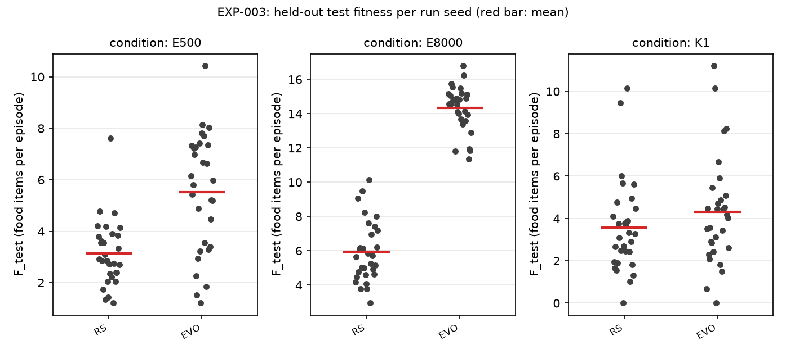
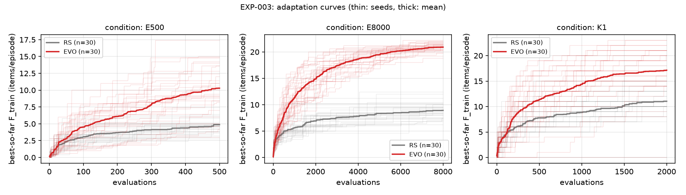

<!-- SPDX-License-Identifier: LicenseRef-EVOLVE-NC-Research-1.0 -->
# EVOLVE run report: EXP-003

Generated 2026-11-24T23:47:59.435860Z by `src/evolve/report.py` from `results/confirmatory/EXP-003`. Label(s): confirmatory. All results are simulations of a synthetic grid world.

Confirmatory runs under a frozen protocol.

## Runs

180 runs (180 ok, 0 failed). Code revision(s): 5d39c9bf1eae.

## TAB-1. Summary by condition and arm

| condition | arm | n ok | n failed | F_test mean (sd) | F_test min to max | F_train_fresh mean | F_shift mean | gap mean | AUC mean | geno div | behav div | stay frac | s/run mean |
|---|---|---|---|---|---|---|---|---|---|---|---|---|---|
| E500 | EVO | 30 | 0 | 5.511 (2.309) | 1.205 to 10.440 | 5.566 | 4.037 | 0.055 | 6.736 | 3.89 | 0.357 | 0.087 | 1.10 |
| E500 | RS | 30 | 0 | 3.143 (1.287) | 1.220 to 7.615 | 3.188 | 2.376 | 0.044 | 3.664 | 21.67 | 0.622 | 0.152 | 1.16 |
| E8000 | EVO | 30 | 0 | 14.319 (1.315) | 11.365 to 16.805 | 14.510 | 9.629 | 0.191 | 16.948 | 6.31 | 0.310 | 0.010 | 10.33 |
| E8000 | RS | 30 | 0 | 5.945 (1.792) | 2.940 to 10.140 | 5.885 | 4.228 | -0.061 | 7.453 | 21.72 | 0.614 | 0.094 | 12.51 |
| K1 | EVO | 30 | 0 | 4.312 (2.569) | 0.000 to 11.220 | 4.356 | 3.402 | 0.045 | 13.278 | 4.92 | 0.365 | 0.226 | 0.51 |
| K1 | RS | 30 | 0 | 3.561 (2.227) | 0.000 to 10.140 | 3.510 | 2.387 | -0.051 | 8.587 | 21.69 | 0.619 | 0.151 | 0.50 |

Units: fitness in food items per episode; gap = F_train_fresh - F_test; s/run = wall-clock seconds.

K = 1 overfitting measure (fixed training environment only): K1 EVO: F_train_fixed 17.133, F_train_fixed - F_test 12.821 (sd 4.023); K1 RS: F_train_fixed 11.033, F_train_fixed - F_test 7.472 (sd 2.370) (items per episode, mean over run seeds).

## TAB-2. Paired contrasts on F_test (unit: run seed)

Mean paired difference with a 95 percent percentile bootstrap interval over run seeds (10000 resamples, analysis seed 0); d_z = mean / SD of the differences; Wilcoxon signed-rank (normal approximation) as a robustness check. MDE = normal-approximation minimum detectable mean difference at 80 percent power and two-sided alpha 0.05, using the observed SD of differences.

| condition | contrast | n pairs | mean diff | 95% CI | SD diff | d_z | Wilcoxon p | MDE n | MDE 20 | MDE 30 |
|---|---|---|---|---|---|---|---|---|---|---|
| E500 | EVO - RS | 30 | 2.368 | [1.627, 3.128] | 2.129 | 1.11 | 0.0000 | 1.089 | 1.334 | 1.089 |
| E8000 | EVO - RS | 30 | 8.374 | [7.418, 9.287] | 2.722 | 3.08 | 0.0000 | 1.392 | 1.705 | 1.392 |
| K1 | EVO - RS | 30 | 0.751 | [-0.533, 1.998] | 3.569 | 0.21 | 0.1567 | 1.826 | 2.236 | 1.826 |

## FIG-1

*FIG-1.* Held-out test fitness of the returned policy, one point per run seed, per arm and condition. Red bar: mean over seeds. Unit: food items per episode.

## FIG-2

*FIG-2.* Best-so-far training fitness (mean of K training episodes) against the number of evaluations. Thin lines: individual run seeds; thick lines: mean over seeds. Training fitness of the best of many noisy evaluations is biased upwards (winner's curse); held-out fitness is in FIG-1.

## Failures

None.

## Degenerate-case checks

- Returned policies with F_test = 0: 2 ['EXP-003.K1.EVO.s0013', 'EXP-003.K1.RS.s0013']
- Returned policies with stay fraction above 0.5 on the test set: 7 ['EXP-003.E500.RS.s0010', 'EXP-003.K1.EVO.s0000', 'EXP-003.K1.EVO.s0005', 'EXP-003.K1.EVO.s0013', 'EXP-003.K1.EVO.s0020', 'EXP-003.K1.RS.s0013', 'EXP-003.K1.RS.s0022']
- Runs whose best training fitness reached the ceiling (24 items): 0 []
- Final populations with zero behavioural diversity: 0 []
- Replay check (consumed items equal the decrease of food on the grid): enforced in every simulated episode; a violation aborts the run.
