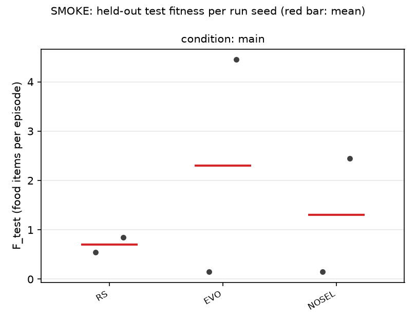
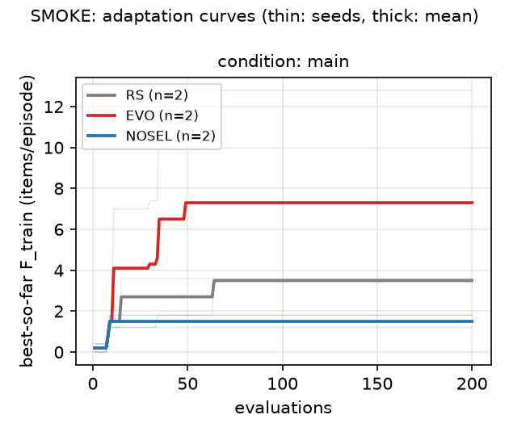

<!-- SPDX-License-Identifier: LicenseRef-EVOLVE-NC-Research-1.0 -->
# EVOLVE exploratory smoke run (not a finding)

Generated 2026-11-24T16:10:19.071955Z by `src/evolve/report.py` from `results/exploratory/smoke-2026-11-24`. Label(s): exploratory. All results are simulations of a synthetic grid world.

**EXPLORATORY. NOT A FINDING.** These runs were executed before the protocol freeze, on the exploratory test pool and exploratory run seeds. They exist to measure runtime, seed spread and degenerate cases for planning. They must not be cited as evidence or pooled with confirmatory runs.

## Runs

6 runs (6 ok, 0 failed). Code revision(s): d06c290d8c64.

## TAB-1. Summary by condition and arm

| condition | arm | n ok | n failed | F_test mean (sd) | F_test min to max | F_train_fresh mean | F_shift mean | gap mean | AUC mean | geno div | behav div | stay frac | s/run mean |
|---|---|---|---|---|---|---|---|---|---|---|---|---|---|
| main | EVO | 2 | 0 | 2.300 (3.041) | 0.150 to 4.450 | 3.125 | 3.500 | 0.825 | 6.527 | 2.50 | 0.272 | 0.295 | 0.71 |
| main | NOSEL | 2 | 0 | 1.300 (1.626) | 0.150 to 2.450 | 2.575 | 2.700 | 1.275 | 1.451 | 5.19 | 0.162 | 0.184 | 0.89 |
| main | RS | 2 | 0 | 0.700 (0.212) | 0.550 to 0.850 | 1.325 | 0.700 | 0.625 | 3.115 | 21.76 | 0.719 | 0.131 | 0.93 |

Units: fitness in food items per episode; gap = F_train_fresh - F_test; s/run = wall-clock seconds.

## TAB-2. Paired contrasts on F_test (unit: run seed)

Mean paired difference with a 95 percent percentile bootstrap interval over run seeds (10000 resamples, analysis seed 0); d_z = mean / SD of the differences; Wilcoxon signed-rank (normal approximation) as a robustness check. MDE = normal-approximation minimum detectable mean difference at 80 percent power and two-sided alpha 0.05, using the observed SD of differences.

| condition | contrast | n pairs | mean diff | 95% CI | SD diff | d_z | Wilcoxon p | MDE n | MDE 20 | MDE 30 |
|---|---|---|---|---|---|---|---|---|---|---|
| main | EVO - RS | 2 | 1.600 | [-0.400, 3.600] | 2.828 | 0.57 | 0.6547 | 5.603 | 1.772 | 1.447 |
| main | NOSEL - RS | 2 | 0.600 | [-0.400, 1.600] | 1.414 | 0.42 | 0.6547 | 2.802 | 0.886 | 0.723 |
| main | EVO - NOSEL | 2 | 1.000 | [0.000, 2.000] | 1.414 | 0.71 | 0.3173 | 2.802 | 0.886 | 0.723 |

In exploratory reports these intervals describe planning quantities (seed spread) only. They are not tests of the registered hypotheses.

## FIG-1

*FIG-1.* Held-out test fitness of the returned policy, one point per run seed, per arm and condition. Red bar: mean over seeds. Unit: food items per episode.

## FIG-2

*FIG-2.* Best-so-far training fitness (mean of K training episodes) against the number of evaluations. Thin lines: individual run seeds; thick lines: mean over seeds. Training fitness of the best of many noisy evaluations is biased upwards (winner's curse); held-out fitness is in FIG-1.

## Failures

None.

## Degenerate-case checks

- Returned policies with F_test = 0: 0 []
- Returned policies with stay fraction above 0.5 on the test set: 0 []
- Runs whose best training fitness reached the ceiling (24 items): 0 []
- Final populations with zero behavioural diversity: 0 []
- Replay check (consumed items equal the decrease of food on the grid): enforced in every simulated episode; a violation aborts the run.
